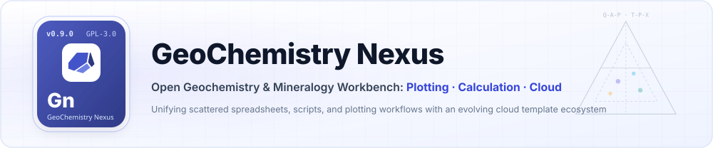
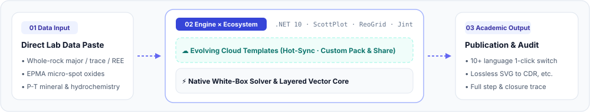

 

**English** · [简体中文](./readme/README.zh-CN.md) · [繁體中文](./readme/README.zh-TW.md) · [Deutsch](./readme/README.de-DE.md) · [Español](./readme/README.es-ES.md) · [Français](./readme/README.fr-FR.md) · [日本語](./readme/README.ja-JP.md) · [한국어](./readme/README.ko-KR.md) · [Português](./readme/README.pt-BR.md) · [Русский](./readme/README.ru-RU.md)

<kbd>📥 <a href="https://github.com/MaxwellLei/GeoChemistry-Nexus/releases"><strong>Download Latest Installer</strong></a></kbd> &nbsp; <kbd>🌐 <a href="https://geochemistry-nexus.pages.dev/docs/intro"><strong>Website &amp; Online Docs</strong></a></kbd> &nbsp; <kbd>🧪 <a href="#-co-building-the-open-geoscience-ecosystem"><strong>Submit Diagrams / Formulas</strong></a></kbd> &nbsp; <kbd>💬 <a href="https://github.com/MaxwellLei/GeoChemistry-Nexus/issues"><strong>Feedback &amp; Issues</strong></a></kbd>

---

## 💡 Why Build GeoChemistry Nexus?

In geochemistry, petrology, mineralogy, and ore deposit research, everyday workflows are often fragmented across disconnected tools: cleaning tables in spreadsheets, running geothermobarometers or mineral structural formulas in standalone scripts or legacy utilities, and switching to general illustration software to trace base maps—a disjointed chain prone to manual coordinate errors. Meanwhile, many classic geoscience tools have stopped receiving updates, while newly published discrimination diagrams, thermobarometric calibrations, and correction schemes often remain locked inside paper appendices without an open channel to reach peers.

True to its name, **Nexus** adopts a decoupled **"High-Performance Native Core + Living Cloud Template Ecosystem"** architecture: the desktop client stays ultra-lightweight and responsive, while upper-layer **discrimination diagrams, geothermobarometers, electron probe microanalysis (EPMA) mineral models, and desktop micro-widgets continuously expand in the cloud** alongside the latest literature—delivering new scientific models directly without upgrading the software.

  

## 🧭 What You Can Do

Built around a complete **"Whole-Rock Geochemistry — Micro-Area Mineralogy — Daily Geoscience Utilities"** loop, every template-driven workspace supports continuous cloud updates and custom extensions (for UI screenshots and walkthroughs, visit the [Official Website & Online Docs](https://geochemistry-nexus.pages.dev/docs/intro)):

1. **Discrimination Diagrams & Multidimensional Visualization**: Combines a cloud template library, personal workspace, and general plotting tools. Built-in templates expand continuously from igneous classification and tectonic discrimination into metamorphic, sedimentary, and ore-genesis systems—paired with native REE / trace-element spider diagrams (multiple built-in normalization standards), multi-panel Harker diagrams, and 2D / ternary scatter plots.
2. **Geothermobarometers & Free Formula Sheet**: Continuously curates single-mineral and mineral-pair geothermobarometers, oxybarometers, hygrometers, and saturation temperature models in the cloud. Run guided batch calculations with fill-handle dragging, or open a standalone free sheet to type Excel-like `=FuncName()` formulas and compare multiple calibrations side by side.
3. **EPMA Mineral Formula Calculation**: Tailored for micro-area oxide analyses, the online template library steadily covers rock-forming silicates, accessory minerals, and oxide / sulfide groups—automating oxygen- or cation-basis normalization, crystallographic site allocation (`apfu`), end-member breakdown, and `Fe³⁺/Fe²⁺` charge-balance estimation.
4. **CIPW Normative Mineralogy**: Batch-converts 12 major and 7 minor / volatile components (including `CO₂ / SO₃ / F / Cl / S` oxygen-replacement corrections) into 30+ ideal normative minerals (`wt.%`), automatically handling measured iron or `Fe³⁺/ΣFe` splitting with real-time silica saturation, alumina saturation index, and `10⁻⁶`-level mass-balance closure checks.
5. **Niggli Parameters & Molecular Norm**: Uses cation percentages (`cat.%`) to eliminate mass-fraction bias from heavy elements such as Fe, closely reflecting thin-section modal mineral volumes. Outputs full Niggli values (`si, al, fm, c, alk, k, mg, qz, ti, p`) and the Barth–Niggli Catanorm in a single pass, complete with plagioclase `An%`, Mg-index, and the 7-step desilication chain.
6. **Geoscience Resource Portal & Handy Toolbox**: Aggregates direct access to authoritative geochemical databases (`GEOROC`, `EarthChem`, `PetDB`, `GeoReM`, etc.) alongside an expanding suite of interactive micro-tools—including a geochemical periodic table, ICS international chronostratigraphic chart card, element↔oxide converter, geological unit converter, water alkalinity / hardness calculator, and blackbody radiation calculator.

## ✨ Core Features

1. **Multilingual Templates, One-Click Language Switching**: Powered by an underlying multilingual lexicon-mapping architecture, the exact same plotted diagram switches seamlessly across Simplified Chinese, Traditional Chinese, English, German, French, Spanish, Russian, Japanese, Korean, Portuguese, and more with a single click.
2. **Publication-Grade Vectors, Direct Handoff to Vector Editors**: Fine-tune styles across 7 vector layer types on the canvas (data points, text, arrows, custom function curves, segments, polygons, and axes); beyond exporting `SVG / PNG / JPG / BMP` or copying straight to the clipboard, launch Inkscape, CorelDRAW, or Adobe Illustrator in one click without manual intermediate file saving.
3. **White-Box Verification, Row-Level Status Lights & Step Traceability**: Say goodbye to black-box calculations that output numbers without context. Every row in the Geothermobarometer, EPMA, CIPW, and Niggli sheets features dynamic diagnostic status indicators—click any sample to inspect normalization factors, intermediate logarithmic terms, iron-valence handling, and desilication consumption step by step for peer-review auditing and teaching.
4. **Programmable Templates, Built-In Visual & Script Builders**: Ships with visual editors for diagrams, geothermobarometers, and EPMA models plus a sandboxed `Jint` JavaScript engine. Newly published discrimination boundaries or empirical thermodynamic equations can be packaged with multilingual labels and RTF literature notes without recompiling the app—ready for instant team sharing or submission to the official cloud library.

## 📦 Download & System Requirements

Visit [**GitHub Releases**](https://github.com/MaxwellLei/GeoChemistry-Nexus/releases) to download the latest Windows installer. No Python / R or other external environments required.

| Item | Specification |
| :--- | :--- |
| 🖥️ **Operating System** | Windows 7 SP1 / Windows 10 / Windows 11 (64-bit x64) |
| ⚙️ **Runtime** | [.NET 10.0 Desktop Runtime (x64)](https://dotnet.microsoft.com/download/dotnet/10.0) |
| ⚡ **Package Size** | Client core approx. `9 MB` (framework-dependent build without .NET runtime) |

## 🗺️ Roadmap

GeoChemistry Nexus is a long-term open-source engineering effort planned for active maintenance over five years and beyond. Alongside frequent additions to the cloud template library, development is advancing steadily across three stages (see full details in [Online Docs · Roadmap](https://geochemistry-nexus.pages.dev/docs/Roadmap)):

<table>
  <tr>
    <td width="33.3%" valign="top">
      
<strong>🟢 Stage 1 · Ready &amp; Continuously Growing</strong>

      
<strong>Core Petrology &amp; Mineral Chemistry Loop</strong>

      <ul>
        <li>Multidisciplinary discrimination, spider &amp; multi-panel Harker plots</li>
        <li>Excel-like geothermobarometers &amp; free-formula comparison sheets</li>
        <li>Cloud template library for EPMA mineral structural formulas</li>
        <li>White-box CIPW &amp; Niggli / Catanorm solvers</li>
        <li>10+ language localization &amp; direct third-party vector handoff</li>
      </ul>
    </td>
    <td width="33.3%" valign="top">
      
<strong>🔵 Stage 2 · Near-Term Focus</strong>

      
<strong>Isotope Geochronology &amp; Geochemical Fractals</strong>

      <ul>
        <li>Zircon U-Pb Concordia plotting module</li>
        <li><code>Rb-Sr</code> / <code>Sm-Nd</code> / <code>Lu-Hf</code> multi-system isochrons</li>
        <li><code>C-N</code> / <code>C-A</code> geochemical fractal &amp; multifractal models</li>
        <li>Log–log piecewise fitting &amp; automated background / anomaly thresholding</li>
      </ul>
    </td>
    <td width="33.3%" valign="top">
      
<strong>🟣 Stage 3 · Medium- &amp; Long-Term Vision</strong>

      
<strong>Intelligent Discrimination &amp; Cross-Platform Ecosystem</strong>

      <ul>
        <li>Python-free machine-learning classification &amp; evaluation for geochemistry</li>
        <li>Extensible big-data-trained "new diagram" discrimination models</li>
        <li>RAG scientific assistant grounded in geoscience literature &amp; built-in docs</li>
        <li>Evaluate <code>Avalonia UI</code> architecture for native macOS / Linux support</li>
      </ul>
    </td>
  </tr>
</table>

## 🤝 Co-Building the Open Geoscience Ecosystem

> [!IMPORTANT]
> **🧪 To Earth Science Researchers & Research Groups: Make Your New Diagrams & Formulas Directly Callable Worldwide!**
>
> If you or your team have published new **tectonic/petrogenetic discrimination diagrams, geothermobarometers, oxybarometers, or mineral-chemistry calculation methods**, you are warmly invited to package them or reach out to have them included in the official cloud template library! Every accepted template prominently displays **full original paper citations, author credits, and personal/lab homepage links** inside the software's help panel and contributor acknowledgments—turning published methods into living tools used daily by peers worldwide.

| Area | How You Can Join |
| :--- | :--- |
| 📈 **Diagrams & Algorithms** | Share custom template packages, recommend classic or frontier formulas for inclusion, or help verify boundary conditions and benchmark datasets |
| 💻 **Code & Architecture** | Developers familiar with `C# / WPF`, scientific visualization, spreadsheet engines, or geochemical numerical computing are welcome to fork and submit Pull Requests |
| 🌍 **Multilingual Proofreading** | Help refine geoscience terminology localization and online tutorials across Chinese, English, German, French, Spanish, Russian, Japanese, Korean, Portuguese, and more |
| 🐛 **Bug Reports & Ideas** | Spot a calculation discrepancy, UI issue, or have a feature idea? Open an issue anytime on [GitHub Issues](https://github.com/MaxwellLei/GeoChemistry-Nexus/issues) |

### 💬 Contact & Community

1. **Author Email**: [`maxwelllei@qq.com`](mailto:maxwelllei@qq.com) (diagram/algorithm submissions, academic & project collaboration)
2. **QQ Group**: `1076647740`
3. **Discord Community**: https://discord.gg/mRm8dbwa4W
4. **Issues & Suggestions**: [GitHub Issues](https://github.com/MaxwellLei/GeoChemistry-Nexus/issues)

## ⭐ Star History

🙏 Special thanks to [all contributors involved in template building, testing feedback, and multilingual proofreading](https://geochemistry-nexus.pages.dev/docs/Special%20Thanks)

**✨ If GeoChemistry Nexus saves time in your research or teaching, please light up the `Star ⭐` in the top-right corner to support its long-term evolution! ✨**

Building open-source software in a specialized Earth Science niche is no easy journey—we genuinely need your attention and support. Every Star and every recommendation to colleagues or labmates is the greatest motivation keeping this project moving forward!

