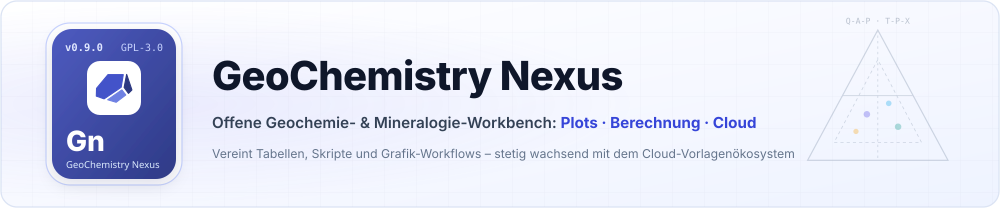
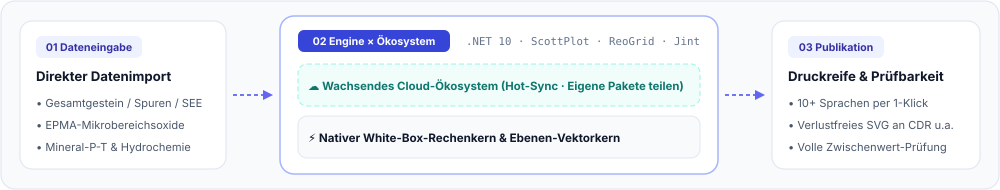

 

[English](../README.md) · [简体中文](./README.zh-CN.md) · [繁體中文](./README.zh-TW.md) · **Deutsch** · [Español](./README.es-ES.md) · [Français](./README.fr-FR.md) · [日本語](./README.ja-JP.md) · [한국어](./README.ko-KR.md) · [Português](./README.pt-BR.md) · [Русский](./README.ru-RU.md)

<kbd>📥 <a href="https://github.com/MaxwellLei/GeoChemistry-Nexus/releases"><strong>Neuesten Installer herunterladen</strong></a></kbd> &nbsp; <kbd>🌐 <a href="https://geochemistry-nexus.pages.dev/de/docs/intro"><strong>Website &amp; Online-Doku</strong></a></kbd> &nbsp; <kbd>🧪 <a href="#-gemeinsam-ein-offenes-geowissenschafts-ökosystem-aufbauen"><strong>Neue Diagramme / Formeln einreichen</strong></a></kbd> &nbsp; <kbd>💬 <a href="https://github.com/MaxwellLei/GeoChemistry-Nexus/issues"><strong>Feedback &amp; Vorschläge</strong></a></kbd>

---

## 💡 Warum GeoChemistry Nexus?

In der Geochemie, Petrologie, Mineralogie und Lagerstättenforschung ist der Forschungsalltag oft über viele Einzelprogramme verstreut: Datenaufbereitung in Tabellenkalkulationen, Geothermobarometrie und Mineralformelberechnung in Skripten oder veralteten Programmen und anschließendes Nachzeichnen von Basisdiagrammen in Grafikprogrammen – ein fragmentierter Ablauf, der bei manueller Übertragung leicht zu Koordinatenfehlern führt. Gleichzeitig werden viele klassische geowissenschaftliche Werkzeuge kaum noch gepflegt, während neu publizierte Diskriminationsdiagramme, Thermobarometer-Kalibrierungen und Korrekturverfahren oft in Artikelanhängen verbleiben.

Wie der Name **Nexus (Verbindungsknoten)** andeutet, setzt dieses Projekt auf eine entkoppelte Architektur aus **„nativem Hochleistungskern + lebendigem Cloud-Vorlagenökosystem“**: Der Desktop-Client bleibt extrem schlank und reaktionsschnell, während **Diskriminationsdiagramme, Geothermobarometer, EPMA-Mineralmodelle und Mikro-Werkzeuge in der Cloud laufend mit der Fachliteratur mitwachsen** – ganz ohne Programm-Upgrade.

  

## 🧭 Funktionsumfang

Rund um den geschlossenen Kreislauf „Gesteinsgeochemie – Mikrobereichs-Mineralogie – tägliche geowissenschaftliche Berechnungen“ unterstützen alle vorlagenbasierten Module laufende Cloud-Updates und eigene Erweiterungen (Screenshots und Anleitungen unter [Offizielle Website & Online-Dokumentation](https://geochemistry-nexus.pages.dev/de/docs/intro)):

1. **Diskriminationsdiagramme & mehrdimensionale Visualisierung**: Vereint Cloud-Vorlagenbibliothek, persönlichen Arbeitsbereich und allgemeine Plot-Werkzeuge. Integrierte Diagramme wachsen stetig von Magmatit-Klassifikation und tektonischer Diskrimination hin zu Metamorphit-, Sediment- und Lagerstättensystemen – ergänzt durch native SEE-/Spurenelement-Spiderdiagramme (mit zahlreichen Normierungsschemata), Harker-Mehrfachdiagramme sowie 2D- und Ternär-Streudiagramme.
2. **Geothermobarometer & freies Formelblatt**: Fortlaufend gepflegte Cloud-Sammlung von Einzelmineral- und Mineralpaar-Thermobarometern, Oxybarometern, Hygrometern und Sättigungstemperatur-Modellen. Unterstützt sowohl geführte Stapelberechnungen per Ausfüllkästchen als auch ein freies Arbeitsblatt mit Excel-ähnlichen `=Funktionsname()`-Aufrufen zum direkten Quervergleich mehrerer Kalibrierungen.
3. **EPMA-Mikrosonden-Mineralberechnung**: Für punktuelle Oxidanalysen deckt die Online-Vorlagenbibliothek kontinuierlich gesteinsbildende Silikate, Akzessorien sowie Oxid-/Sulfidgruppen ab – inklusive Sauerstoff- oder Kationen-Normierung, Gitterplatzbesetzung (`apfu`), Endgliedzerlegung und `Fe³⁺/Fe²⁺`-Ladungsbilanzschätzung.
4. **CIPW-Normmineralberechnung**: Stapelberechnung von über 30 idealen Normmineralen (`wt.%`) aus 12 Haupt- und 7 Neben-/Volatilkomponenten (inkl. `CO₂ / SO₃ / F / Cl / S`-Sauerstoffersatzkorrektur), automatischer Erkennung gemessener Eisenwerte oder `Fe³⁺/ΣFe`-Aufteilung sowie Echtzeit-Prüfung von Silikatsättigung, Aluminiumsättigungsindex und `10⁻⁶`-Massenbilanzschluss.
5. **Niggli-Parameter & molekulare Kationennorm**: Nutzt Kationenprozente (`cat.%`), um die Massenverzerrung schwerer Elemente wie Eisen zu beseitigen und reale Dünnschliff-Volumenanteile besser abzubilden. Liefert in einem Durchgang vollständige Niggli-Werte (`si, al, fm, c, alk, k, mg, qz, ti, p`) und die Barth–Niggli-Catanorm samt Plagioklas-`An%`, Mg-Index und 7-stufiger Entkieselungskette.
6. **Geowissenschaftliches Portal & Werkzeugkasten**: Bündelt Direktzugänge zu führenden Datenbanken (`GEOROC`, `EarthChem`, `PetDB`, `GeoReM` u. a.) sowie stetig wachsende Kompaktwerkzeuge wie interaktives geochemisches Periodensystem, internationale ICS-Chronostratigraphiekarte, Element↔Oxid-Rechner, Einheitenumrechner sowie Wasseralkalinitäts-/-härte- und Schwarzkörperstrahlungs-Rechner.

## ✨ Kernmerkmale

1. **Mehrsprachige Vorlagen, Sprachwechsel per Klick**: Dank mehrsprachiger Begriffs-Mapping-Architektur lassen sich Diagrammbeschriftungen derselben Auswertung verlustfrei mit einem Klick zwischen Vereinfachtem und Traditionellem Chinesisch, Englisch, Deutsch, Französisch, Spanisch, Russisch, Japanisch, Koreanisch, Portugiesisch und weiteren Sprachen umschalten.
2. **Publikationsreife Vektorgrafik, Direktübergabe an Grafikprogramme**: 7 Vektorebenen auf der Zeichenfläche (Datenpunkte, Text, Pfeile, Funktionskurven, Liniensegmente, Polygone, Achsen) erlauben präzise Stilfeinabstimmung; neben `SVG / PNG / JPG / BMP`-Export und Zwischenablage-Kopieren lassen sich Grafiken ohne Zwischenspeichern mit einem Klick direkt in Inkscape, CorelDRAW oder Adobe Illustrator öffnen.
3. **White-Box-Prüfung mit Zeilen-Statusanzeige & Prozessnachweis**: Keine Black-Box-Ergebnisse ohne Rechenweg. Jede Zeile in Geothermobarometer-, EPMA-, CIPW- und Niggli-Tabellen besitzt dynamische Diagnose-Statuslampen; per Klick auf eine Probe lassen sich Normierungsfaktoren, logarithmische Zwischenterme, Eisenwertigkeits-Behandlung und Entkieselungsschritte lückenlos für Gutachten und Lehre nachvollziehen.
4. **Programmierbare Vorlagen mit Visuell- & Skript-Editor**: Integrierte visuelle Editoren für Diagramme, Thermobarometer und EPMA sowie eine abgesicherte `Jint`-JavaScript-Sandbox ermöglichen es Forschungsgruppen, neue Diskriminationsgrenzen oder thermodynamische Gleichungen samt mehrsprachigen Texten und RTF-Literaturhinweisen ohne Neukompilierung als Standardpaket zu teilen oder für die Cloud-Bibliothek einzureichen.

## 📦 Download & Systemanforderungen

Laden Sie den aktuellen Windows-Installer unter [**GitHub Releases**](https://github.com/MaxwellLei/GeoChemistry-Nexus/releases) herunter. Es ist keine Einrichtung von Python / R oder anderen Umgebungen erforderlich.

### 📥 Welchen Installer soll ich wählen?

Jede Version enthält zwei Installer mit identischem Funktionsumfang. Der einzige Unterschied: Ist die .NET-Laufzeit enthalten oder nicht?

| Installer | Beispiel-Dateiname | Beschreibung | Geeignet für |
| :--- | :--- | :--- | :--- |
| ✅ **Vollversion (empfohlen)** | `GeoChemistryNexus-Setup-<Version>-x64.exe` | Enthält die .NET 10 Desktop Runtime; ist sie auf dem Rechner nicht vorhanden, installiert der Installer sie automatisch und unbemerkt im Hintergrund | Die meisten Nutzer, besonders bei Erstinstallation oder wenn unklar ist, ob .NET bereits installiert ist |
| 🪶 **Lite-Version** | `GeoChemistryNexus-Setup-<Version>-x64-lite.exe` | Dateiname endet auf `-lite`; enthält die .NET-Laufzeit **nicht** und ist daher deutlich kleiner | Nutzer, die die [.NET 10 Desktop Runtime (x64)](https://dotnet.microsoft.com/download/dotnet/10.0) bereits installiert haben, oder die Downloadvolumen sparen möchten |

> [!NOTE]
> - Der Lite-Installer prüft zuerst, ob die .NET 10 Desktop Runtime vorhanden ist. **Wird sie nicht gefunden, zeigt er einen Hinweis an und bricht die Installation ab, ohne Dateien zu schreiben.** Laden Sie dann stattdessen die Vollversion herunter oder installieren Sie die .NET-Laufzeit selbst und starten Sie Lite erneut.
> - Sie sind unsicher? Laden Sie einfach die **Vollversion** herunter.

### 💻 Systemanforderungen

| Bereich | Anforderung |
| :--- | :--- |
| 🖥️ **Betriebssystem** | Windows 7 SP1 / Windows 10 / Windows 11 (64-Bit x64) |
| ⚙️ **Laufzeitumgebung** | [.NET 10.0 Desktop Runtime (x64)](https://dotnet.microsoft.com/download/dotnet/10.0) (in der Vollversion enthalten und wird automatisch installiert; bei Lite vorab selbst zu installieren) |
| ⚡ **Paketgröße** | Client-Hauptprogramm ca. `9 MB` (Version ohne enthaltenes .NET-Runtime) |

## 🗺️ Roadmap

GeoChemistry Nexus ist als langfristiges Open-Source-Projekt über mindestens fünf Jahre angelegt. Parallel zum laufenden Ausbau der Cloud-Vorlagenbibliothek schreitet die Entwicklung in drei Phasen voran (vollständige Planung unter [Online-Doku · Roadmap](https://geochemistry-nexus.pages.dev/de/docs/Roadmap)):

<table>
  <tr>
    <td width="33.3%" valign="top">
      
<strong>🟢 Phase 1 · Einsatzbereit &amp; stetig wachsend</strong>

      
<strong>Kernkreislauf Gesteins- &amp; Mineralchemie</strong>

      <ul>
        <li>Fachübergreifende Diskriminations-, Spider- &amp; Harker-Mehrfachplots</li>
        <li>Excel-ähnliche Geothermobarometer &amp; freie Formelvergleichstabellen</li>
        <li>Cloud-Vorlagenbibliothek für EPMA-Mineralstrukturformeln</li>
        <li>White-Box-Berechnung für CIPW &amp; Niggli / Catanorm</li>
        <li>10+ Sprachen &amp; Direktübergabe an Vektorgrafikprogramme</li>
      </ul>
    </td>
    <td width="33.3%" valign="top">
      
<strong>🔵 Phase 2 · Aktueller Schwerpunkt</strong>

      
<strong>Isotopengeochronologie &amp; geochemische Fraktale</strong>

      <ul>
        <li>Zirkon-U-Pb-Konkordia-Diagrammmodul (Concordia)</li>
        <li><code>Rb-Sr</code>- / <code>Sm-Nd</code>- / <code>Lu-Hf</code>-Mehrsystem-Isochronen</li>
        <li>Geochemische <code>C-N</code>- / <code>C-A</code>-Fraktal- &amp; Multifraktalmodelle</li>
        <li>Abschnittsweise Log-Log-Anpassung &amp; automatische Hintergrund-/Anomalieschwellen</li>
      </ul>
    </td>
    <td width="33.3%" valign="top">
      
<strong>🟣 Phase 3 · Mittel- bis langfristige Vision</strong>

      
<strong>Intelligente Diskrimination &amp; Plattform-Ökosystem</strong>

      <ul>
        <li>Python-freie ML-Klassifikation &amp; Modellbewertung für Geochemie</li>
        <li>Erweiterbare, auf großen Datensätzen trainierte „Neue-Diagramm“-Modelle</li>
        <li>RAG-Forschungsassistent mit Fachliteratur &amp; integrierter Wissensbasis</li>
        <li>Evaluierung von <code>Avalonia UI</code> für native macOS- / Linux-Unterstützung</li>
      </ul>
    </td>
  </tr>
</table>

## 🤝 Gemeinsam ein offenes Geowissenschafts-Ökosystem aufbauen

> [!IMPORTANT]
> **🧪 An Forschende & Arbeitsgruppen der Geowissenschaften: Machen Sie Ihre neuen Diagramme und Formeln weltweit direkt nutzbar!**
>
> Wenn Sie oder Ihr Team neue **tektonische/petrogenetische Diskriminationsdiagramme, Geothermobarometer, Oxybarometer oder mineralchemische Berechnungsverfahren** veröffentlicht haben, laden wir Sie herzlich ein, diese als Vorlage zu paketieren oder uns für die Aufnahme in die offizielle Cloud-Bibliothek zu kontaktieren! Jede aufgenommene Vorlage nennt im Hilfebereich **vollständige Originalzitate, Autorinnen/Autoren sowie Links zur persönlichen oder Arbeitsgruppen-Webseite** und wird im Dankverzeichnis aufgeführt.

| Bereich | Wie Sie mitwirken können |
| :--- | :--- |
| 📈 **Diagramme & Algorithmen** | Eigene Vorlagenpakete teilen, klassische oder neue Formeln vorschlagen oder Randbedingungen und Testdatensätze prüfen |
| 💻 **Code & Architektur** | Entwicklerinnen und Entwickler mit Erfahrung in `C# / WPF`, wissenschaftlicher Visualisierung, Tabellen-Engines oder geochemischer Numerik sind eingeladen, das Repo zu forken und Pull Requests einzureichen |
| 🌍 **Mehrsprachige Fachbegriffe** | Lokalisierung geowissenschaftlicher Fachterminologie und Online-Tutorials in Chinesisch, Englisch, Deutsch, Französisch, Spanisch, Russisch, Japanisch, Koreanisch, Portugiesisch u. a. verfeinern |
| 🐛 **Fehlermeldungen & Ideen** | Rechenabweichungen, Bedienprobleme oder Funktionsideen jederzeit gerne unter [GitHub Issues](https://github.com/MaxwellLei/GeoChemistry-Nexus/issues) melden |

### 💬 Kontakt & Austausch

1. **E-Mail des Autors**: [`maxwelllei@qq.com`](mailto:maxwelllei@qq.com) (Einreichung von Diagrammen/Algorithmen, akademische & Projektkooperationen)
2. **QQ-Gruppe**: `1076647740`
3. **Discord-Community**: https://discord.gg/mRm8dbwa4W
4. **Feedback & Vorschläge**: [GitHub Issues](https://github.com/MaxwellLei/GeoChemistry-Nexus/issues)

## ⭐ Star-Entwicklung

🙏 Besonderer Dank gilt [allen Mitwirkenden an Vorlagenaufbau, Testfeedback und mehrsprachigem Lektorat](https://geochemistry-nexus.pages.dev/de/docs/Special%20Thanks)

**✨ Wenn GeoChemistry Nexus Ihnen in Forschung oder Lehre Zeit spart, freuen wir uns über einen `Star ⭐` oben rechts zur Unterstützung der langfristigen Weiterentwicklung! ✨**

Open-Source-Software in einer spezialisierten geowissenschaftlichen Nische aufzubauen ist kein leichter Weg – wir brauchen Ihre Aufmerksamkeit und Unterstützung wirklich sehr: Jeder einzelne Star und jede Weiterempfehlung im Kollegenkreis ist unsere größte Motivation!

