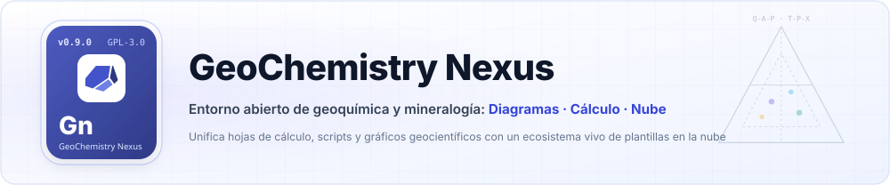
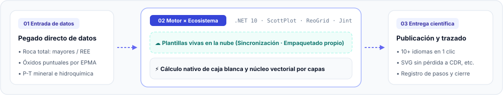

 

[English](../README.md) · [简体中文](./README.zh-CN.md) · [繁體中文](./README.zh-TW.md) · [Deutsch](./README.de-DE.md) · **Español** · [Français](./README.fr-FR.md) · [日本語](./README.ja-JP.md) · [한국어](./README.ko-KR.md) · [Português](./README.pt-BR.md) · [Русский](./README.ru-RU.md)

<kbd>📥 <a href="https://github.com/MaxwellLei/GeoChemistry-Nexus/releases"><strong>Descargar último instalador</strong></a></kbd> &nbsp; <kbd>🌐 <a href="https://geochemistry-nexus.pages.dev/es/docs/intro"><strong>Sitio web y documentación</strong></a></kbd> &nbsp; <kbd>🧪 <a href="#-construyendo-juntos-el-ecosistema-abierto-de-geociencias"><strong>Enviar diagramas / fórmulas</strong></a></kbd> &nbsp; <kbd>💬 <a href="https://github.com/MaxwellLei/GeoChemistry-Nexus/issues"><strong>Comentarios y sugerencias</strong></a></kbd>

---

## 💡 ¿Por qué construir GeoChemistry Nexus?

En la investigación de geoquímica, petrología, mineralogía y yacimientos minerales, el trabajo diario suele fragmentarse entre múltiples programas: organizar tablas en hojas de cálculo, calcular geotermobarómetros o fórmulas minerales en scripts o utilidades antiguas, y pasar a software general de diseño para redibujar mapas base, lo que rompe el flujo de trabajo e introduce errores manuales de coordenadas. Al mismo tiempo, muchas herramientas geocientíficas clásicas llevan años sin actualizarse, mientras que los nuevos diagramas de discriminación, calibraciones termobarométricas y esquemas de corrección suelen quedarse en los anexos de los artículos sin un canal abierto hacia la comunidad.

Fiel al significado de **Nexus (centro de conexión)**, el proyecto adopta una arquitectura desacoplada de **«núcleo nativo de alto rendimiento + ecosistema vivo de plantillas en la nube»**: el cliente de escritorio se mantiene sumamente ligero y ágil, mientras que los **diagramas de discriminación, geotermobarómetros, modelos minerales de microsonda electrónica (EPMA) y microherramientas crecen continuamente en la nube** al ritmo de la literatura científica, sin necesidad de actualizar el programa.

  

## 🧭 ¿Qué puede hacer?

Diseñado como un ciclo completo de «Geoquímica de roca total — Mineralogía de microárea — Cálculo geocientífico diario», todos los módulos basados en plantillas admiten actualizaciones continuas en la nube y extensiones personalizadas (capturas y guías en el [Sitio web oficial y documentación en línea](https://geochemistry-nexus.pages.dev/es/docs/intro)):

1. **Diagramas de discriminación y visualización multidimensional**: Reúne biblioteca en la nube, espacio personal y diagramas utilitarios. Los modelos integrados se expanden desde clasificación ígnea y ambientes tectónicos hacia sistemas metamórficos, sedimentarios y metalogenéticos, junto con diagramas de araña de REE / elementos traza (con múltiples esquemas de normalización), paneles múltiples de Harker y diagramas de dispersión 2D / ternarios.
2. **Geotermobarómetros y hoja libre de fórmulas**: Incorpora de forma continua geotermobarómetros de mineral único y pares minerales, oxibarómetros, higrómetros y modelos de temperatura de saturación. Permite tanto el cálculo por lotes guiado por columnas como hojas libres independientes donde escribir `=NombreFuncion()` al estilo Excel para comparar múltiples calibraciones en paralelo.
3. **Cálculo mineral de microsonda electrónica (EPMA)**: Orientado a datos puntuales de óxidos, el catálogo en línea abarca silicatos formadores de roca, minerales accesorios y grupos de óxidos / sulfuros, automatizando la normalización por oxígenos o cationes, ocupación estructural (`apfu`), proporciones de términos extremos y estimación de balance de carga `Fe³⁺/Fe²⁺`.
4. **Cálculo normativo CIPW de roca total**: Convierte por lotes 12 componentes mayores y 7 menores / volátiles (con corrección de reemplazo de oxígeno por `CO₂ / SO₃ / F / Cl / S`) en más de 30 minerales normativos ideales (`wt.%`), reconociendo hierro medido o partición `Fe³⁺/ΣFe` con verificación de saturación de sílice, índice de saturación alumínica y cierre de balance de masas a nivel `10⁻⁶`.
5. **Parámetros de Niggli y norma molecular**: Emplea porcentajes catiónicos (`cat.%`) para eliminar el sesgo en peso de elementos pesados como el Fe y reflejar mejor las proporciones volumétricas reales en lámina delgada. Genera simultáneamente los parámetros completos de Niggli (`si, al, fm, c, alk, k, mg, qz, ti, p`) y la Catanorma de Barth–Niggli, incluyendo `An%` de plagioclasa, índice Mg y la cadena de desilicificación en siete pasos.
6. **Portal de recursos geocientíficos y caja de herramientas**: Reúne accesos directos a bases de datos de referencia (`GEOROC`, `EarthChem`, `PetDB`, `GeoReM`, etc.) e integra widgets interactivos en constante ampliación: tabla periódica geoquímica, carta cronoestratigráfica internacional ICS, conversor elemento↔óxido, conversor de unidades geológicas y calculadoras de alcalinidad / dureza del agua y radiación de cuerpo negro.

## ✨ Características principales

1. **Plantillas multilingües, cambio de idioma en un clic**: Gracias a su arquitectura de mapeo léxico multilingüe, un mismo diagrama proyectado cambia sin pérdida y con un solo clic entre chino simplificado y tradicional, inglés, alemán, francés, español, ruso, japonés, coreano, portugués y más idiomas.
2. **Vectores con calidad de publicación y conexión directa a editores**: Las 7 capas vectoriales del lienzo (puntos, texto, flechas, curvas de función, segmentos, polígonos y ejes) admiten ajuste fino de estilo; además de exportar `SVG / PNG / JPG / BMP` o copiar al portapapeles, puede abrir directamente Inkscape, CorelDRAW o Adobe Illustrator en un clic sin guardado intermedio manual.
3. **Verificación de caja blanca, indicadores por fila y trazabilidad**: Sin cálculos opacos que oculten el procedimiento. Cada fila en Geotermobarómetros, EPMA, CIPW y Niggli incorpora indicadores dinámicos de diagnóstico; al seleccionar cualquier muestra se inspeccionan factores de normalización, términos logarítmicos intermedios, tratamiento del estado de oxidación del hierro y consumo de desilicificación para revisión por pares y docencia.
4. **Plantillas programables con editores visuales y de scripts**: Incluye editores visuales para diagramas, termobarómetros y EPMA junto con un entorno seguro JavaScript basado en `Jint`. Los grupos de investigación pueden empaquetar nuevos límites de discriminación o fórmulas termodinámicas con etiquetas multilingües y notas bibliográficas RTF sin recompilar el software, listos para compartir en equipo o enviar a la biblioteca oficial en la nube.

## 📦 Descarga y entorno de ejecución

Visite [**GitHub Releases**](https://github.com/MaxwellLei/GeoChemistry-Nexus/releases) para descargar el último instalador para Windows. No requiere configurar Python / R ni otros entornos externos.

| Elemento | Especificación |
| :--- | :--- |
| 🖥️ **Sistema operativo** | Windows 7 SP1 / Windows 10 / Windows 11 (64 bits x64) |
| ⚙️ **Entorno de ejecución** | [.NET 10.0 Desktop Runtime (x64)](https://dotnet.microsoft.com/download/dotnet/10.0) |
| ⚡ **Tamaño del paquete** | Cliente base aprox. `9 MB` (versión sin el runtime de .NET incluido) |

## 🗺️ Hoja de ruta

GeoChemistry Nexus es un proyecto de código abierto planificado para mantenerse activamente durante más de cinco años. Mientras se amplía de forma continua la biblioteca de plantillas en la nube, el desarrollo avanza en tres etapas (plan completo en [Documentación en línea · Roadmap](https://geochemistry-nexus.pages.dev/es/docs/Roadmap)):

<table>
  <tr>
    <td width="33.3%" valign="top">
      
<strong>🟢 Etapa 1 · Lista y en crecimiento continuo</strong>

      
<strong>Ciclo central de petrología y química mineral</strong>

      <ul>
        <li>Diagramas discriminantes multidisciplinares, araña y paneles Harker</li>
        <li>Geotermobarómetros estilo Excel y hojas libres comparativas</li>
        <li>Biblioteca en la nube de fórmulas estructurales minerales EPMA</li>
        <li>Resolución de caja blanca para CIPW y Niggli / Catanorma</li>
        <li>Más de 10 idiomas y conexión directa con editores vectoriales</li>
      </ul>
    </td>
    <td width="33.3%" valign="top">
      
<strong>🔵 Etapa 2 · Prioridad a corto plazo</strong>

      
<strong>Geocronología isotópica y fractales geoquímicos</strong>

      <ul>
        <li>Módulo de diagramas Concordia U-Pb en circón</li>
        <li>Isócronas multisistema <code>Rb-Sr</code> / <code>Sm-Nd</code> / <code>Lu-Hf</code></li>
        <li>Modelos fractales y multifractales geoquímicos <code>C-N</code> / <code>C-A</code></li>
        <li>Ajuste por tramos log–log y separación automática fondo / anomalía</li>
      </ul>
    </td>
    <td width="33.3%" valign="top">
      
<strong>🟣 Etapa 3 · Visión a medio y largo plazo</strong>

      
<strong>Modelos inteligentes y ecosistema multiplataforma</strong>

      <ul>
        <li>Clasificación y evaluación con aprendizaje automático sin Python</li>
        <li>Modelos extensibles de «nuevos diagramas» entrenados con macrodatos</li>
        <li>Asistente científico RAG integrado con literatura y base documental</li>
        <li>Evaluación de <code>Avalonia UI</code> para soporte nativo en macOS / Linux</li>
      </ul>
    </td>
  </tr>
</table>

## 🤝 Construyendo juntos el ecosistema abierto de geociencias

> [!IMPORTANT]
> **🧪 A investigadores y grupos de Ciencias de la Tierra: ¡haga que sus nuevos diagramas y fórmulas sean utilizados directamente en todo el mundo!**
>
> Si usted o su equipo han publicado nuevos **diagramas de discriminación tectónica/petrogenética, geotermobarómetros, oxibarómetros o métodos de cálculo de química mineral**, le invitamos a empaquetarlos o contactarnos para incorporarlos en la biblioteca oficial en la nube. Toda plantilla incluida muestra de forma destacada **la cita completa del artículo original, autoría y enlaces a la página personal o del grupo de investigación**, además de figurar en los agradecimientos oficiales.

| Dirección | Cómo participar |
| :--- | :--- |
| 📈 **Diagramas y algoritmos** | Compartir paquetes de plantillas propios, recomendar fórmulas clásicas o recientes, o ayudar a validar condiciones de contorno y conjuntos de prueba |
| 💻 **Código y arquitectura** | Desarrolladores familiarizados con `C# / WPF`, visualización científica, motores de hojas de cálculo o cálculo numérico geoquímico pueden hacer Fork y enviar Pull Requests |
| 🌍 **Revisión terminológica** | Ayudar a pulir la localización de terminología geocientífica y tutoriales en chino, inglés, alemán, francés, español, ruso, japonés, coreano, portugués y otros idiomas |
| 🐛 **Errores y sugerencias** | Si detecta desviaciones de cálculo, detalles de interfaz o nuevas ideas, envíelos en cualquier momento a [GitHub Issues](https://github.com/MaxwellLei/GeoChemistry-Nexus/issues) |

### 💬 Contacto y comunidad

1. **Correo del autor**: [`maxwelllei@qq.com`](mailto:maxwelllei@qq.com) (envío de diagramas/algoritmos, colaboración académica y de proyectos)
2. **Grupo de QQ**: `1076647740`
3. **Comunidad de Discord**: https://discord.gg/mRm8dbwa4W
4. **Problemas y sugerencias**: [GitHub Issues](https://github.com/MaxwellLei/GeoChemistry-Nexus/issues)

## ⭐ Historial de Stars

🙏 Agradecimiento especial a [todos los colaboradores en creación de plantillas, pruebas y revisión multilingüe](https://geochemistry-nexus.pages.dev/es/docs/Special%20Thanks)

**✨ Si GeoChemistry Nexus ahorra tiempo en su investigación o docencia, ¡ilumine la estrella `Star ⭐` arriba a la derecha para apoyar su evolución a largo plazo! ✨**

Desarrollar software libre en un ámbito geocientífico especializado no es un camino sencillo; realmente necesitamos su atención y apoyo: ¡cada Star y cada recomendación a colegas y compañeros es el mayor impulso para seguir avanzando!

