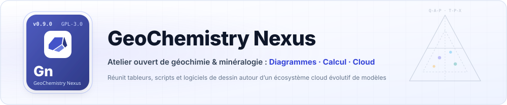
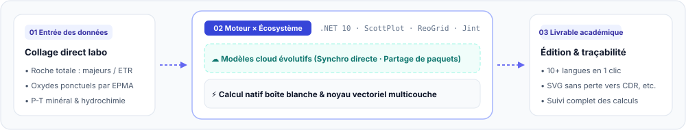

 

[English](../README.md) · [简体中文](./README.zh-CN.md) · [繁體中文](./README.zh-TW.md) · [Deutsch](./README.de-DE.md) · [Español](./README.es-ES.md) · **Français** · [日本語](./README.ja-JP.md) · [한국어](./README.ko-KR.md) · [Português](./README.pt-BR.md) · [Русский](./README.ru-RU.md)

<kbd>📥 <a href="https://github.com/MaxwellLei/GeoChemistry-Nexus/releases"><strong>Télécharger l'installateur</strong></a></kbd> &nbsp; <kbd>🌐 <a href="https://geochemistry-nexus.pages.dev/fr/docs/intro"><strong>Site officiel &amp; documentation</strong></a></kbd> &nbsp; <kbd>🧪 <a href="#-construire-ensemble-un-écosystème-open-source-en-géosciences"><strong>Soumettre diagrammes / formules</strong></a></kbd> &nbsp; <kbd>💬 <a href="https://github.com/MaxwellLei/GeoChemistry-Nexus/issues"><strong>Retours &amp; suggestions</strong></a></kbd>

---

## 💡 Pourquoi concevoir GeoChemistry Nexus ?

En géochimie, pétrologie, minéralogie et métallogénie, le travail quotidien est souvent dispersé entre plusieurs outils : préparation des tableaux dans un tableur, calculs de géothermobarométrie ou de formules structurales dans des scripts ou d'anciens utilitaires, puis bascule vers un logiciel de dessin généraliste pour retracer les fonds de carte — une chaîne morcelée propice aux erreurs manuelles de coordonnées. Parallèlement, nombre d'outils classiques ne sont plus maintenus, tandis que les nouveaux diagrammes discriminants, calibrations thermobarométriques et méthodes de correction restent confinés aux annexes d'articles scientifiques sans canal ouvert de diffusion.

Fidèle au sens de **Nexus (point de convergence)**, ce projet repose sur une architecture découplée associant **« noyau natif haute performance + écosystème vivant de modèles dans le cloud »** : le client de bureau demeure ultra-léger et réactif, tandis que les **diagrammes discriminants, géothermobaromètres, modèles minéralogiques EPMA et micro-outils s'enrichissent continuellement dans le cloud** au fil des publications scientifiques, sans mise à niveau du logiciel.

  

## 🧭 Que permet-il de faire ?

Articulé autour d'une boucle complète « Géochimie sur roche totale — Minéralogie ponctuelle — Calculs géoscientifiques du quotidien », chaque module piloté par modèles prend en charge les mises à jour continues depuis le cloud et les extensions personnalisées (captures et démonstrations sur le [Site officiel et la documentation en ligne](https://geochemistry-nexus.pages.dev/fr/docs/intro)) :

1. **Diagrammes discriminants & visualisation multidimensionnelle** : Réunit bibliothèque cloud, espace personnel et diagrammes utilitaires. Les modèles intégrés s'étendent de la classification des roches ignées et des contextes tectoniques vers le métamorphisme, la sédimentologie et la gitologie, accompagnés de diagrammes arachnides ETR / éléments en traces (multiples normalisations intégrées), planches multiples de Harker et projections 2D / ternaires.
2. **Géothermobaromètres & feuille libre de formules** : Intègre en continu dans le cloud des géothermobaromètres monominéraux et à paires minérales, oxybaromètres, hygromètres et modèles de température de saturation. Permet aussi bien le calcul par lots guidé par poignée de recopie qu'une feuille libre autonome utilisant des appels `=NomFonction()` façon Excel pour comparer plusieurs calibrations côte à côte.
3. **Calcul minéralogique à la microsonde électronique (EPMA)** : Dédié aux analyses ponctuelles d'oxydes, le catalogue en ligne couvre silicates majeurs, minéraux accessoires et familles d'oxydes / sulfures, en automatisant la normalisation sur base d'oxygènes ou de cations, la répartition sur sites cristallographiques (`apfu`), les proportions de pôles purs et l'estimation du bilan de charges `Fe³⁺/Fe²⁺`.
4. **Norme CIPW sur roche totale** : Convertit par lots 12 éléments majeurs et 7 composants mineurs / volatils (avec correction de remplacement d'oxygène `CO₂ / SO₃ / F / Cl / S`) en plus de 30 minéraux normatifs idéaux (`wt.%`), avec prise en compte du fer mesuré ou du rapport `Fe³⁺/ΣFe`, indice de saturation en silice et en alumine, et contrôle de bouclage massique à `10⁻⁶`.
5. **Paramètres de Niggli & norme moléculaire** : Utilise les pourcentages cationiques (`cat.%`) pour éliminer le biais massique des éléments lourds tels que le fer et mieux refléter les proportions volumiques observées en lame mince. Produit simultanément l'ensemble des paramètres de Niggli (`si, al, fm, c, alk, k, mg, qz, ti, p`) et la Catanorme de Barth–Niggli, avec `%An` du plagioclase, indice Mg et séquence de désilicification en sept étapes.
6. **Portail de ressources géoscientifiques & boîte à outils** : Regroupe des accès directs aux bases de données de référence (`GEOROC`, `EarthChem`, `PetDB`, `GeoReM`, etc.) ainsi qu'une suite évolutive de micro-outils : classification périodique géochimique interactive, charte chronostratigraphique internationale ICS, convertisseur élément↔oxyde, convertisseur d'unités géologiques et calculateurs d'alcalinité / dureté de l'eau et de rayonnement du corps noir.

## ✨ Fonctionnalités clés

1. **Modèles multilingues, changement de langue en un clic** : Grâce à son architecture de correspondance lexicale multilingue, un même diagramme projeté bascule instantanément et sans perte entre chinois simplifié et traditionnel, anglais, allemand, français, espagnol, russe, japonais, coréen, portugais et d'autres langues.
2. **Vecteurs prêts pour l'édition & liaison directe aux logiciels de dessin** : Les 7 couches vectorielles du canevas (points, textes, flèches, courbes de fonctions, segments, polygones, axes) offrent un réglage précis du style ; outre l'export `SVG / PNG / JPG / BMP` et la copie dans le presse-papiers, un clic ouvre directement Inkscape, CorelDRAW ou Adobe Illustrator sans enregistrement intermédiaire manuel.
3. **Vérification « boîte blanche », voyants d'état par ligne & traçabilité** : Fini les calculs opaques sans détail intermédiaire. Chaque ligne des feuilles Géothermobarométrie, EPMA, CIPW et Niggli dispose d'un voyant de diagnostic dynamique ; cliquez sur un échantillon pour inspecter facteurs de normalisation, termes logarithmiques intermédiaires, gestion de la valence du fer et étapes de désilicification lors des relectures d'articles ou de l'enseignement.
4. **Modèles programmables, éditeurs visuels & moteur de script intégrés** : Intègre des éditeurs visuels pour diagrammes, géothermobaromètres et EPMA ainsi qu'un bac à sable JavaScript `Jint`. Les équipes de recherche peuvent encapsuler de nouvelles limites discriminantes ou formules thermodynamiques avec libellés multilingues et notes bibliographiques RTF sans recompiler le logiciel, pour un partage immédiat ou une intégration au cloud officiel.

## 📦 Téléchargement & environnement requis

Rendez-vous sur [**GitHub Releases**](https://github.com/MaxwellLei/GeoChemistry-Nexus/releases) pour télécharger le dernier installateur Windows. Aucune configuration Python / R ou autre environnement externe n'est requise.

| Élément | Spécification |
| :--- | :--- |
| 🖥️ **Système d'exploitation** | Windows 7 SP1 / Windows 10 / Windows 11 (64 bits x64) |
| ⚙️ **Environnement d'exécution** | [.NET 10.0 Desktop Runtime (x64)](https://dotnet.microsoft.com/download/dotnet/10.0) |
| ⚡ **Taille du logiciel** | Client principal env. `9 MB` (version sans le runtime .NET inclus) |

## 🗺️ Feuille de route

GeoChemistry Nexus est un projet open source de long terme prévu pour être maintenu sur plus de cinq ans. Tout en enrichissant fréquemment la bibliothèque cloud de modèles, le développement progresse selon trois étapes (détails complets dans [Documentation en ligne · Roadmap](https://geochemistry-nexus.pages.dev/fr/docs/Roadmap)) :

<table>
  <tr>
    <td width="33.3%" valign="top">
      
<strong>🟢 Étape 1 · Opérationnelle &amp; en croissance continue</strong>

      
<strong>Boucle fondamentale de pétrologie &amp; chimie minérale</strong>

      <ul>
        <li>Diagrammes discriminants, arachnides &amp; planches multiples de Harker</li>
        <li>Géothermobaromètres type Excel &amp; feuilles libres comparatives</li>
        <li>Bibliothèque cloud de formules structurales minérales EPMA</li>
        <li>Calcul boîte blanche CIPW &amp; Niggli / Catanorme</li>
        <li>Plus de 10 langues &amp; liaison directe aux éditeurs vectoriels</li>
      </ul>
    </td>
    <td width="33.3%" valign="top">
      
<strong>🔵 Étape 2 · Priorités à court terme</strong>

      
<strong>Géochronologie isotopique &amp; fractales géochimiques</strong>

      <ul>
        <li>Module de diagrammes Concordia U-Pb sur zircon</li>
        <li>Isochrones multisystèmes <code>Rb-Sr</code> / <code>Sm-Nd</code> / <code>Lu-Hf</code></li>
        <li>Modèles fractals et multifractals géochimiques <code>C-N</code> / <code>C-A</code></li>
        <li>Ajustement log–log par morceaux &amp; seuillage automatique fond / anomalie</li>
      </ul>
    </td>
    <td width="33.3%" valign="top">
      
<strong>🟣 Étape 3 · Vision à moyen et long terme</strong>

      
<strong>Discrimination intelligente &amp; écosystème multiplateforme</strong>

      <ul>
        <li>Classification &amp; évaluation par apprentissage automatique sans Python</li>
        <li>Modèles extensibles de « nouveaux diagrammes » entraînés sur grands jeux de données</li>
        <li>Assistant scientifique RAG appuyé sur la littérature et la base documentaire</li>
        <li>Évaluation d'<code>Avalonia UI</code> pour une prise en charge native macOS / Linux</li>
      </ul>
    </td>
  </tr>
</table>

## 🤝 Construire ensemble un écosystème open source en géosciences

> [!IMPORTANT]
> **🧪 Aux chercheurs et équipes en Sciences de la Terre : rendez vos nouveaux diagrammes et formules directement utilisables par la communauté mondiale !**
>
> Si vous ou votre laboratoire avez publié de nouveaux **diagrammes discriminants tectoniques/pétrogénétiques, géothermobaromètres, oxybaromètres ou méthodes de calcul minéralogique**, n'hésitez pas à les empaqueter ou à nous contacter pour les intégrer à la bibliothèque cloud officielle ! Chaque modèle référencé affiche clairement **la référence complète de l'article original, les auteurs ainsi que les liens vers votre page personnelle ou d'équipe**, et figure dans la liste officielle des contributeurs.

| Domaine | Comment contribuer |
| :--- | :--- |
| 📈 **Diagrammes & algorithmes** | Partager vos paquets de modèles, suggérer des formules classiques ou récentes, ou vérifier les domaines de validité et jeux d'essai |
| 💻 **Code & architecture** | Les développeurs familiers de `C# / WPF`, de la visualisation scientifique, des moteurs de tableur ou du calcul numérique géochimique sont invités à forker le dépôt et soumettre des Pull Requests |
| 🌍 **Relecture terminologique** | Affiner la localisation de la terminologie géoscientifique et des tutoriels en chinois, anglais, allemand, français, espagnol, russe, japonais, coréen, portugais, etc. |
| 🐛 **Signalements & idées** | Un écart de calcul, un détail d'interface ou une idée de fonctionnalité ? Ouvrez un ticket à tout moment sur [GitHub Issues](https://github.com/MaxwellLei/GeoChemistry-Nexus/issues) |

### 💬 Contact & échanges

1. **Courriel de l'auteur** : [`maxwelllei@qq.com`](mailto:maxwelllei@qq.com) (soumission de diagrammes/algorithmes, collaborations académiques et projets)
2. **Groupe QQ** : `1076647740`
3. **Communauté Discord** : https://discord.gg/mRm8dbwa4W
4. **Retours & suggestions** : [GitHub Issues](https://github.com/MaxwellLei/GeoChemistry-Nexus/issues)

## ⭐ Évolution des Stars

🙏 Remerciements particuliers à [tous les contributeurs impliqués dans la création de modèles, les retours de tests et la relecture multilingue](https://geochemistry-nexus.pages.dev/fr/docs/Special%20Thanks)

**✨ Si GeoChemistry Nexus vous fait gagner du temps en recherche ou en enseignement, pensez à cliquer sur `Star ⭐` en haut à droite pour soutenir son évolution sur le long terme ! ✨**

Développer un logiciel open source dans une discipline spécialisée des sciences de la Terre n'est pas une aventure facile — nous avons sincèrement besoin de votre attention et de votre soutien : chaque Star et chaque recommandation auprès de vos collègues est notre plus grande source de motivation !

