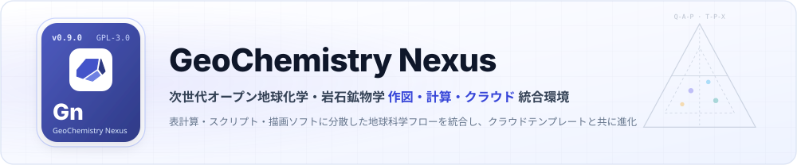

 

[English](../README.md) · [简体中文](./README.zh-CN.md) · [繁體中文](./README.zh-TW.md) · [Deutsch](./README.de-DE.md) · [Español](./README.es-ES.md) · [Français](./README.fr-FR.md) · **日本語** · [한국어](./README.ko-KR.md) · [Português](./README.pt-BR.md) · [Русский](./README.ru-RU.md)

<kbd>📥 <a href="https://github.com/MaxwellLei/GeoChemistry-Nexus/releases"><strong>最新インストーラーを入手</strong></a></kbd> &nbsp; <kbd>🌐 <a href="https://geochemistry-nexus.pages.dev/ja/docs/intro"><strong>公式サイト・ドキュメント</strong></a></kbd> &nbsp; <kbd>🧪 <a href="#-地球科学オープンソースエコシステムの共創"><strong>新しい図解・計算式の投稿</strong></a></kbd> &nbsp; <kbd>💬 <a href="https://github.com/MaxwellLei/GeoChemistry-Nexus/issues"><strong>フィードバック・要望</strong></a></kbd>

---

## 💡 なぜ GeoChemistry Nexus を構築するのか？

地球化学・岩石学・鉱物学・鉱床学の研究現場では、日常の作業が複数のツールに分断されがちです。表計算ソフトでデータを整え、スクリプトや旧式のプログラムで地質温圧計や鉱物構造式を計算し、さらに汎用ドローソフトへ移して基図をトレースする——工程が途切れるだけでなく、手作業による転記は座標誤差の原因にもなります。また、定番の地球科学ツールの多くが長年更新を停止している一方で、新しく発表された判別図や温圧校正モデル、補正手法は論文の付録に留まり、研究コミュニティへ広く届く仕組みが不足していました。

**Nexus（結節点）** という名の通り、本プロジェクトは **「ネイティブ高性能コア ＋ 進化し続けるクラウドテンプレート生態系」** の分離設計を採用しています。クライアント本体を極めて軽量・高速に保ちながら、上位の **判別図・地質温圧計・EPMA（電子線マイクロアナライザ）鉱物モデル・デスクトップ小ツール群を最新の研究進展に合わせてクラウド上で継続的に拡充** し、ソフト本体のアップデートなしで最新モデルをそのまま利用できます。

  

## 🧭 できること

「全岩地球化学 — 微小領域鉱物学 — 日常の地球科学計算」を一気通貫で結び、すべてのテンプレート駆動モジュールがクラウドからの随時追加とカスタム拡張に対応しています（画面例や操作手順は [公式サイト・オンラインドキュメント](https://geochemistry-nexus.pages.dev/ja/docs/intro) をご覧ください）：

1. **判別図と多次元可視化**：クラウドテンプレートライブラリ、個人ワークスペース、汎用プロットツールを統合。内蔵テンプレートは火成岩分類やテクトニック環境判別から変成・堆積・鉱床成因分野へと継続的に拡充されており、希土類（REE）・微量元素スパイダー図（多数の規格化スキームを内蔵）、Harker 多連図、2次元・三角散布図も標準搭載しています。
2. **地質温圧計と自由数式シート**：単鉱物・鉱物ペア温圧計をはじめ、酸素フガシティー計、湿度計、飽和温度モデルをクラウドで継続収録。テンプレート列に沿ったオートフィル一括計算に加え、独立した自由ワークシートを開いて Excel のように `=関数名()` を入力し、複数の校正モデルを横並びで比較できます。
3. **EPMA 鉱物構造式計算**：微小領域の酸化物分析データに向け、造岩珪酸塩・副成分鉱物・酸化物／硫化物グループをオンラインテンプレートで順次カバー。酸素数または陽イオン基準の規格化、結晶サイト配分（`apfu`）、端成分比率の算出、`Fe³⁺/Fe²⁺` 電荷バランス推定を自動化します。
4. **CIPW ノルム鉱物計算**：主要 12 成分および微量・揮発性 7 成分（`CO₂ / SO₃ / F / Cl / S` 酸素置換補正を含む）から 30 種以上の理想ノルム鉱物（`wt.%`）を一括算出。実測鉄の自動認識または `Fe³⁺/ΣFe` 分割に対応し、珪酸飽和度・アルミナ飽和指数および `10⁻⁶` レベルの質量収支チェックをリアルタイム表示します。
5. **Niggli パラメータと分子ノルム**：陽イオン百分率（`cat.%`）を用いることで鉄など重元素による重量比の偏りを除き、薄片観察での実際の鉱物体積比により近い評価を実現。1回の入力で完全な Niggli 値（`si, al, fm, c, alk, k, mg, qz, ti, p`）と Barth–Niggli 分子ノルム（Catanorm）、斜長石 `An%`、Mg 指数、7段階の脱珪酸過程を同時出力します。
6. **地球科学ポータルと実用ツールボックス**：ホーム画面に `GEOROC`、`EarthChem`、`PetDB`、`GeoReM` など主要データベースへの直通リンクを集約。さらにインタラクティブ地球化学周期表、ICS 国際年代層序早見カード、元素↔酸化物換算、地質単位換算、水質アルカリ度／硬度計算、黒体放射計算などの軽量ウィジェットを継続的に拡充しています。

## ✨ 主な特長

1. **多言語対応テンプレート、ワンクリックで言語切替**：多言語辞書マッピング構造により、同じプロット結果のまま簡体字・繁体字中国語、英語、ドイツ語、フランス語、スペイン語、ロシア語、日本語、韓国語、ポルトガル語など多様な言語ラベルへワンクリックで無劣化切替できます。
2. **出版品質のベクター描画、主要ドローソフトへ直結**：キャンバス上の 7 種類のベクターレイヤー（データ点、テキスト、矢印、カスタム関数曲線、線分、ポリゴン、座標軸）で細かなスタイル調整が可能。`SVG / PNG / JPG / BMP` 出力やクリップボードコピーに加え、一時保存の手間なくワンクリックで Inkscape・CorelDRAW・Adobe Illustrator を起動して組版仕上げへ移行できます。
3. **ホワイトボックス検証、行ごとの診断ランプと計算過程の追跡**：「結果だけ出して途中経過が分からない」ブラックボックス計算を排し、温圧計・EPMA・CIPW・Niggli の各行に動的ステータスランプを搭載。任意の試料を選択すると規格化係数、中間対数項、鉄価数の処理法、脱珪酸消費量をサイドパネルで逐一確認でき、査読対応や教育での検算に最適です。
4. **プログラマブルなテンプレート、ビジュアル＆スクリプトビルダー内蔵**：判別図・温圧計・EPMA 用のビジュアルエディタと `Jint` JavaScript サンドボックスを内蔵。研究室で新しく発表した判別境界や熱力学経験式を、ソフトの再コンパイルなしで多言語ラベル・RTF 文献解説付きの標準パッケージにまとめ、チーム内共有や公式クラウドへの登録が可能です。

## 📦 ダウンロードと動作環境

[**GitHub Releases**](https://github.com/MaxwellLei/GeoChemistry-Nexus/releases) より最新の Windows インストーラーをダウンロードしてください。Python / R などの外部環境構築は一切不要です。

### 📥 インストーラーの選び方

各バージョンには 2 種類のインストーラーがあり、機能はまったく同じです。違いは .NET ランタイムを同梱しているかどうかだけです。

| インストーラー | ファイル名の例 | 説明 | こんな方向け |
| :--- | :--- | :--- | :--- |
| ✅ **完全版（推奨）** | `GeoChemistryNexus-Setup-<バージョン>-x64.exe` | .NET 10 デスクトップ ランタイムを同梱。PC に未インストールの場合は、インストーラーが自動的にサイレントインストールします | ほとんどの方。特に初めてインストールする方や、.NET が入っているか分からない方 |
| 🪶 **軽量版（Lite）** | `GeoChemistryNexus-Setup-<バージョン>-x64-lite.exe` | ファイル名の末尾が `-lite`。.NET ランタイムを**同梱せず**、ダウンロードサイズが大幅に小さくなります | すでに [.NET 10 Desktop Runtime (x64)](https://dotnet.microsoft.com/download/dotnet/10.0) をインストール済みの方、通信量を節約したい方 |

> [!NOTE]
> - 軽量版は起動時にまず .NET 10 デスクトップ ランタイムの有無を確認します。**検出できない場合はメッセージを表示し、ファイルを一切書き込まずにインストールを中止します。** その場合は完全版をダウンロードするか、.NET ランタイムを先にインストールしてから再度実行してください。
> - どちらを選べばよいか迷ったら、**完全版**をダウンロードしてください。

### 💻 動作環境

| 項目 | 仕様・要件 |
| :--- | :--- |
| 🖥️ **対応 OS** | Windows 7 SP1 / Windows 10 / Windows 11（64 ビット x64） |
| ⚙️ **ランタイム** | [.NET 10.0 Desktop Runtime (x64)](https://dotnet.microsoft.com/download/dotnet/10.0)（完全版インストーラーは同梱・自動インストール、軽量版は事前に各自でインストールが必要） |
| ⚡ **本体サイズ** | クライアント本体 約 `9 MB`（.NET ランタイム非同梱版） |

## 🗺️ ロードマップ

GeoChemistry Nexus は 5 年以上の長期にわたる継続メンテナンスを見据えたオープンソースプロジェクトです。既存のクラウドテンプレート拡充と並行し、以下の 3 段階で着実に開発を進めています（詳細は [オンラインドキュメント · Roadmap](https://geochemistry-nexus.pages.dev/ja/docs/Roadmap) を参照）：

<table>
  <tr>
    <td width="33.3%" valign="top">
      
<strong>🟢 フェーズ 1 · 提供中＆継続拡充</strong>

      
<strong>岩石・鉱物化学のコア基盤</strong>

      <ul>
        <li>多分野の判別図・スパイダー図・Harker 多連図</li>
        <li>Excel 風の地質温圧計＆自由数式比較シート</li>
        <li>EPMA 鉱物構造式クラウドテンプレートライブラリ</li>
        <li>CIPW および Niggli / Catanorm ホワイトボックス計算</li>
        <li>10 言語以上の国際化＆外部ベクターソフト直結連携</li>
      </ul>
    </td>
    <td width="33.3%" valign="top">
      
<strong>🔵 フェーズ 2 · 直近の重点開発</strong>

      
<strong>同位体年代学と地球化学フラクタル</strong>

      <ul>
        <li>ジルコン U-Pb コンコーディア図（Concordia）作図モジュール</li>
        <li><code>Rb-Sr</code> / <code>Sm-Nd</code> / <code>Lu-Hf</code> 等の多元アイソクロン</li>
        <li><code>C-N</code> / <code>C-A</code> 等の地球化学フラクタル・マルチフラクタルモデル</li>
        <li>両対数区分回帰フィットと地化学探査のバックグラウンド／異常閾値自動区分</li>
      </ul>
    </td>
    <td width="33.3%" valign="top">
      
<strong>🟣 フェーズ 3 · 中長期ビジョン</strong>

      
<strong>知的判別モデルとマルチプラットフォーム</strong>

      <ul>
        <li>Python 環境不要の地球化学機械学習分類・評価</li>
        <li>大規模データ学習による拡張型「新判別図」モデルの読込対応</li>
        <li>地球科学文献と内蔵知識ベースを統合した RAG 研究アシスタント</li>
        <li><code>Avalonia UI</code> 採用検討による macOS / Linux ネイティブ対応</li>
      </ul>
    </td>
  </tr>
</table>

## 🤝 地球科学オープンソースエコシステムの共創

> [!IMPORTANT]
> **🧪 地球科学の研究者・研究室の皆様へ：新しい判別図や計算式を世界中の研究者がすぐ使える形にしませんか！**
>
> 皆様や研究グループで新しい **構造／成因判別図、地質温圧計、酸素フガシティー計、鉱物化学計算手法** を発表された際は、ぜひテンプレート化またはご連絡のうえ公式クラウドライブラリへご登録ください。収録されたすべてのテンプレートには、ソフト内の解説パネルに **原著論文の引用情報・著者名・個人／研究室の Web サイトリンク** が明記され、貢献者一覧にも掲載されます。

| 参加分野 | 参加・貢献の方法 |
| :--- | :--- |
| 📈 **図解・アルゴリズム共創** | 自作テンプレートパッケージの共有、収録してほしい定番／最新式の推薦、既存モデルの境界条件やテストデータの検証 |
| 💻 **コード・設計への貢献** | `C# / WPF`、科学可視化、表計算エンジン、地球化学数値計算に詳しい開発者の方の Fork および Pull Request を歓迎します |
| 🌍 **多言語専門用語の校閲** | 中国語・英語・ドイツ語・フランス語・スペイン語・ロシア語・日本語・韓国語・ポルトガル語等の専門用語ローカライズやチュートリアル翻訳の改善 |
| 🐛 **不具合報告・機能提案** | 計算の差異や UI の改善点、新機能のアイデアはいつでも [GitHub Issues](https://github.com/MaxwellLei/GeoChemistry-Nexus/issues) へお寄せください |

### 💬 連絡先・コミュニティ

1. **開発者メール**：[`maxwelllei@qq.com`](mailto:maxwelllei@qq.com)（図解・アルゴリズムの投稿、学術・プロジェクト連携）
2. **QQ 交流グループ**：`1076647740`
3. **Discord コミュニティ**：https://discord.gg/mRm8dbwa4W
4. **不具合報告・要望**：[GitHub Issues](https://github.com/MaxwellLei/GeoChemistry-Nexus/issues)

## ⭐ Star 推移

🙏 [テンプレート構築・テスト報告・多言語校閲にご協力いただいたすべての貢献者の皆様](https://geochemistry-nexus.pages.dev/ja/docs/Special%20Thanks)に心より感謝申し上げます

**✨ GeoChemistry Nexus が皆様の研究や教育の時間短縮にお役に立ちましたら、ぜひ右上の `Star ⭐` を押して長期的な開発を応援してください！ ✨**

地球科学という専門分野でのオープンソース開発は決して平坦な道のりではありません。皆様からの関心と応援が本当に大きな支えになります——一つひとつの Star や周囲の研究仲間へのご紹介が、開発を続ける最大の原動力です！

