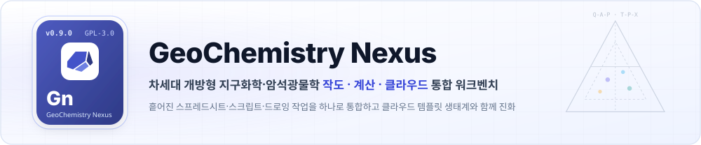

 

[English](../README.md) · [简体中文](./README.zh-CN.md) · [繁體中文](./README.zh-TW.md) · [Deutsch](./README.de-DE.md) · [Español](./README.es-ES.md) · [Français](./README.fr-FR.md) · [日本語](./README.ja-JP.md) · **한국어** · [Português](./README.pt-BR.md) · [Русский](./README.ru-RU.md)

<kbd>📥 <a href="https://github.com/MaxwellLei/GeoChemistry-Nexus/releases"><strong>최신 설치 파일 다운로드</strong></a></kbd> &nbsp; <kbd>🌐 <a href="https://geochemistry-nexus.pages.dev/ko/docs/intro"><strong>공식 웹사이트 및 문서</strong></a></kbd> &nbsp; <kbd>🧪 <a href="#-지구과학-오픈소스-생태계-함께-만들기"><strong>새 도해 / 수식 제출</strong></a></kbd> &nbsp; <kbd>💬 <a href="https://github.com/MaxwellLei/GeoChemistry-Nexus/issues"><strong>문제 제보 및 건의</strong></a></kbd>

---

## 💡 왜 GeoChemistry Nexus를 만들었나요?

지구화학·암석학·광물학·광상학 연구에서는 일상적인 작업이 여러 프로그램에 흩어져 있는 경우가 많습니다. 스프레드시트에서 데이터를 정리하고, 별도의 스크립트나 오래된 프로그램으로 지질 온압계와 광물 화학식을 계산한 뒤, 다시 범용 그래픽 프로그램으로 옮겨 바탕 도면을 따라 그리는 과정에서 흐름이 끊길 뿐 아니라 수작업 전사로 인한 좌표 오차도 발생하기 쉽습니다. 또한 기존의 많은 지학 도구들이 오랫동안 업데이트되지 않는 반면, 새로 발표되는 판별 도해·온압 보정식·보정 모델은 논문 부록에만 머물러 동료 연구자들에게 널리 전달될 열린 통로가 부족했습니다.

이름 속 **Nexus(연결 허브)** 가 뜻하듯, 본 프로젝트는 **「네이티브 고성능 코어 + 살아 움직이는 클라우드 템플릿 생태계」** 의 분리형 아키텍처를 채택했습니다. 클라이언트 본체는 매우 가볍고 쾌적하게 유지하면서, 상위의 **판별 도해·지질 온압계·전자현미분석(EPMA) 광물 모델·데스크톱 미니 도구함을 최신 학술 문헌에 맞춰 클라우드에서 지속적으로 업데이트 및 확충**하여 소프트웨어 업그레이드 없이도 최신 연구 모델을 바로 사용할 수 있습니다.

  

## 🧭 무엇을 할 수 있나요?

「전암 지구화학 — 미소영역 광물학 — 일상 지학 계산」의 완결된 순환 구조를 중심으로, 모든 템플릿 기반 모듈은 클라우드 상시 업데이트와 사용자 정의 확장을 지원합니다(화면 스크린샷 및 사용 예시는 [공식 웹사이트 및 온라인 문서](https://geochemistry-nexus.pages.dev/ko/docs/intro) 참조):

1. **판별 도해 및 다차원 시각화**: 클라우드 템플릿 라이브러리, 개인 작업 공간, 범용 작도 도구를 하나로 통합했습니다. 내장 도해는 화성암 분류와 지구조 배경 판별에서 변성·퇴적·광상 성인 등 다학제 체계로 계속 확장되며, 희토류(REE)/미량원소 거미줄 도해(다양한 표준화 방안 내장), Harker 다중 패널 도해 및 2차원/삼각 산점도를 기본 제공합니다.
2. **지질 온압계 및 자유 수식 시트**: 단광물·광물쌍 지질 온압계와 산소 분압계, 습도계, 포화 온도 모델을 클라우드에서 지속적으로 수록·개선합니다. 템플릿 열 안내에 따라 채우기 핸들을 끌어 일괄 계산할 수 있을 뿐 아니라, 독립된 자유 워크시트를 열어 Excel처럼 `=함수명()`을 입력해 여러 보정식을 한 시트에서 나란히 비교할 수 있습니다.
3. **EPMA 전자현미분석 광물 계산**: 미소영역 산화물 점분석 데이터를 위해 조암 규산염, 부성분 광물 및 산화물/황화물 계열 템플릿을 온라인으로 폭넓게 지원하며, 산소 또는 양이온 기준 정규화, 결정 자리 배분(`apfu`), 단성분 비율 분해 및 `Fe³⁺/Fe²⁺` 전하 균형 추정을 자동으로 수행합니다.
4. **CIPW 전암 표준광물 계산**: 주원소 12종과 미량/휘발성 성분 7종(`CO₂ / SO₃ / F / Cl / S` 산소 치환 보정 포함)으로부터 30여 종의 이상적 표준광물(`wt.%`)을 일괄 환산하며, 실측 철 자동 인식 또는 `Fe³⁺/ΣFe` 분할, 규산 포화도·알루미나 포화 지수 및 `10⁻⁶` 수준의 질량 균형 폐합 검증을 실시간으로 제공합니다.
5. **Niggli 파라미터 및 분자 표준광물**: 양이온 백분율(`cat.%`)을 사용해 철 등 무거운 원소가 질량 분율에서 일으키는 편향을 제거하여 박편 내 실제 광물 부피 비율에 더욱 부합합니다. 한 번의 입력으로 전체 Niggli 파라미터(`si, al, fm, c, alk, k, mg, qz, ti, p`)와 Barth–Niggli 분자 표준광물(Catanorm), 사장석 `An%`, Mg 지수 및 7단계 탈규산 과정을 동시에 출력합니다.
6. **지구과학 리소스 포털 및 간편 도구함**: 홈 화면에 `GEOROC`, `EarthChem`, `PetDB`, `GeoReM` 등 권위 있는 지구화학 데이터베이스 바로가기를 모았으며, 대화형 지구화학 주기율표, ICS 국제 층서 연대표 카드, 원소↔산화물 환산기, 지질 단위 환산기, 수질 알칼리도/경도 및 흑체 복사 계산기 등 경량 위젯을 계속해서 확충하고 있습니다.

## ✨ 핵심 특징

1. **다국어 템플릿, 클릭 한 번으로 언어 전환**: 도해 하부에 다국어 어휘 매핑 구조를 적용하여, 동일한 투점 결과물을 중국어 간체·번체, 영어, 독일어, 프랑스어, 스페인어, 러시아어, 일본어, 한국어, 포르투갈어 등 다양한 언어 표기로 손실 없이 즉시 전환할 수 있습니다.
2. **출판급 벡터 그래픽, 주요 편집 프로그램 직결**: 캔버스 내 7종 벡터 레이어(데이터 점, 텍스트, 화살표, 사용자 정의 함수 곡선, 선분, 다각형, 좌표축)의 세밀한 스타일 조정을 지원하며, `SVG / PNG / JPG / BMP` 내보내기와 클립보드 복사는 물론 중간 파일 저장 없이 클릭 한 번으로 Inkscape, CorelDRAW, Adobe Illustrator를 바로 호출해 편집을 이어갈 수 있습니다.
3. **화이트박스 검증, 행별 상태등 및 계산 과정 추적**: 결과만 보여주고 과정은 알 수 없는 블랙박스 계산을 지양합니다. 온압계·EPMA·CIPW·Niggli 시트의 모든 행에 동적 진단 상태등이 제공되며, 임의의 시료를 클릭하면 정규화 계수, 중간 로그항, 철 원자가 처리 방식 및 탈규산 반응 소모량을 사이드 패널에서 항목별로 검토할 수 있어 논문 심사 소명과 교육용 검산에 편리합니다.
4. **프로그래밍 가능한 템플릿, 내장 비주얼 및 스크립트 빌더**: 도해·온압계·EPMA 비주얼 편집기와 `Jint` JavaScript 스크립트 샌드박스를 내장했습니다. 연구실에서 새로 발표한 판별 경계선이나 열역학 경험식을 프로그램 재컴파일 없이 다국어 용어와 RTF 문헌 설명이 포함된 표준 템플릿 패키지로 묶어 팀원 간 공유하거나 공식 클라우드 라이브러리에 등록할 수 있습니다.

## 📦 다운로드 및 실행 환경

[**GitHub Releases**](https://github.com/MaxwellLei/GeoChemistry-Nexus/releases)에서 최신 Windows 설치 파일을 다운로드하세요. Python / R 등 별도의 외부 환경을 구성할 필요가 없습니다.

| 항목 | 사양 요구사항 |
| :--- | :--- |
| 🖥️ **운영체제** | Windows 7 SP1 / Windows 10 / Windows 11 (64비트 x64) |
| ⚙️ **실행 환경** | [.NET 10.0 Desktop Runtime (x64)](https://dotnet.microsoft.com/download/dotnet/10.0) |
| ⚡ **소프트웨어 용량** | 클라이언트 본체 약 `9 MB` (.NET 런타임 미포함 버전) |

## 🗺️ 로드맵

GeoChemistry Nexus는 5년 이상 장기 유지보수를 목표로 하는 오픈소스 엔지니어링 프로젝트입니다. 기존 클라우드 템플릿 라이브러리를 꾸준히 확충하는 동시에 다음 세 단계에 걸쳐 체계적으로 발전하고 있습니다(전체 계획은 [온라인 문서 · Roadmap](https://geochemistry-nexus.pages.dev/ko/docs/Roadmap) 참조):

<table>
  <tr>
    <td width="33.3%" valign="top">
      
<strong>🟢 1단계 · 구축 완료 및 지속 확장</strong>

      
<strong>암석·광물화학 핵심 워크플로</strong>

      <ul>
        <li>다학제 판별 도해, 거미줄 도해 및 Harker 다중 패널 도해</li>
        <li>Excel형 지질 온압계 및 자유 수식 비교 시트</li>
        <li>EPMA 미소영역 광물 구조식 클라우드 템플릿 라이브러리</li>
        <li>CIPW 및 Niggli / Catanorm 화이트박스 계산</li>
        <li>10개 이상 다국어 현지화 및 외부 벡터 소프트웨어 직결</li>
      </ul>
    </td>
    <td width="33.3%" valign="top">
      
<strong>🔵 2단계 · 단기 중점 추진</strong>

      
<strong>동위원소 연대측정 및 지구화학 프랙탈</strong>

      <ul>
        <li>저콘 U-Pb 조화도(Concordia) 작도 모듈</li>
        <li><code>Rb-Sr</code> / <code>Sm-Nd</code> / <code>Lu-Hf</code> 등 다원 등시선도</li>
        <li><code>C-N</code> / <code>C-A</code> 등 지구화학 프랙탈 및 다중 프랙탈 모델</li>
        <li>양대수 구간 회귀 피팅 및 지화학 탐사 배경값 / 이상치 하한 자동 구분</li>
      </ul>
    </td>
    <td width="33.3%" valign="top">
      
<strong>🟣 3단계 · 중장기 비전</strong>

      
<strong>지능형 판별 모델 및 크로스플랫폼 생태계</strong>

      <ul>
        <li>Python 환경 설정이 필요 없는 지구화학 머신러닝 분류 평가</li>
        <li>대규모 데이터로 학습된 확장형 「신규 도해」 판별 모델 로드 지원</li>
        <li>지구과학 문헌과 내장 지식베이스를 결합한 RAG 연구 도우미</li>
        <li><code>Avalonia UI</code> 아키텍처 검토를 통한 macOS / Linux 네이티브 지원</li>
      </ul>
    </td>
  </tr>
</table>

## 🤝 지구과학 오픈소스 생태계 함께 만들기

> [!IMPORTANT]
> **🧪 지구과학 연구자 및 연구실 여러분께: 새로 발표하신 도해와 수식을 전 세계 동료들이 바로 호출해 쓰도록 해보세요!**
>
> 연구자님 또는 연구팀에서 새로운 **지구조/성인 판별 도해, 지질 온압계, 산소 분압계 또는 광물화학 계산법**을 발표하셨다면, 직접 패키징하시거나 저희에게 연락해 공식 클라우드 템플릿 라이브러리에 수록해 보세요! 수록된 모든 템플릿은 소프트웨어 설명 패널에 **원논문 인용 정보, 저자 표기 및 개인/연구실 홈페이지 링크**를 명확히 기재하며 공식 기여자 명단에도 등재됩니다.

| 참여 분야 | 참여 방법 |
| :--- | :--- |
| 📈 **도해 및 알고리즘 공동 구축** | 자체 제작 템플릿 패키지 공유, 수록이 시급한 고전/최신 수식 추천, 기존 모델의 경계 조건 및 테스트 데이터셋 검증 지원 |
| 💻 **코드 및 아키텍처 기여** | `C# / WPF`, 과학 시각화, 스프레드시트 엔진 또는 지구화학 수치 계산에 익숙한 개발자분들의 저장소 Fork 및 Pull Request를 환영합니다 |
| 🌍 **다국어 전문용어 교정** | 중국어, 영어, 독일어, 프랑스어, 스페인어, 러시아어, 일본어, 한국어, 포르투갈어 등 지학 전문용어 현지화 및 온라인 튜토리얼 번역 다듬기 |
| 🐛 **오류 제보 및 기능 건의** | 계산 편차, 인터페이스 불편 사항이나 새로운 기능 아이디어가 있다면 언제든 [GitHub Issues](https://github.com/MaxwellLei/GeoChemistry-Nexus/issues)에 남겨 주세요 |

### 💬 연락 및 소통

1. **개발자 이메일**: [`maxwelllei@qq.com`](mailto:maxwelllei@qq.com) (도해·알고리즘 투고, 학술 및 프로젝트 협력)
2. **QQ 교류 그룹**: `1076647740`
3. **Discord 커뮤니티**: https://discord.gg/mRm8dbwa4W
4. **문제 제보 및 건의**: [GitHub Issues](https://github.com/MaxwellLei/GeoChemistry-Nexus/issues)

## ⭐ Star 증가 추이

🙏 [템플릿 구축, 테스트 피드백 및 다국어 교정에 참여해 주신 모든 기여자분들](https://geochemistry-nexus.pages.dev/ko/docs/Special%20Thanks)께 깊이 감사드립니다

**✨ GeoChemistry Nexus가 연구나 강의 시간을 아껴 드렸다면, 오른쪽 위의 `Star ⭐`를 눌러 프로젝트의 장기적인 발전을 응원해 주세요! ✨**

지구과학이라는 전문 분야에서 오픈소스 소프트웨어를 꾸준히 일구어 가는 일은 결코 쉽지 않습니다. 여러분의 관심과 응원이 정말 절실합니다—눌러 주시는 Star 하나와 주변 동료 연구자분들께 전하는 추천 한마디가 프로젝트를 계속 나아가게 하는 가장 큰 원동력입니다!

