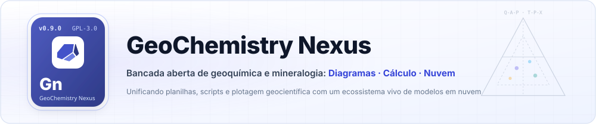
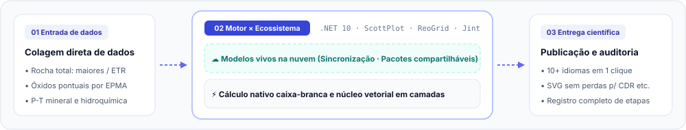

 

[English](../README.md) · [简体中文](./README.zh-CN.md) · [繁體中文](./README.zh-TW.md) · [Deutsch](./README.de-DE.md) · [Español](./README.es-ES.md) · [Français](./README.fr-FR.md) · [日本語](./README.ja-JP.md) · [한국어](./README.ko-KR.md) · **Português** · [Русский](./README.ru-RU.md)

<kbd>📥 <a href="https://github.com/MaxwellLei/GeoChemistry-Nexus/releases"><strong>Baixar instalador mais recente</strong></a></kbd> &nbsp; <kbd>🌐 <a href="https://geochemistry-nexus.pages.dev/pt-BR/docs/intro"><strong>Site oficial e documentação</strong></a></kbd> &nbsp; <kbd>🧪 <a href="#-construindo-juntos-o-ecossistema-aberto-de-geociências"><strong>Enviar diagramas / fórmulas</strong></a></kbd> &nbsp; <kbd>💬 <a href="https://github.com/MaxwellLei/GeoChemistry-Nexus/issues"><strong>Feedback e sugestões</strong></a></kbd>

---

## 💡 Por que construir o GeoChemistry Nexus?

Nas pesquisas em geoquímica, petrologia, mineralogia e metalogênese, o fluxo diário de trabalho costuma ficar fragmentado entre diversos programas: organizar tabelas em planilhas, calcular geotermobarômetros e fórmulas minerais em scripts ou programas antigos, e depois migrar para softwares gráficos gerais para redesenhar mapas-base — um processo desconexo e sujeito a erros manuais de coordenadas. Ao mesmo tempo, muitas ferramentas clássicas de geociências estão sem atualização há anos, enquanto novos diagramas discriminantes, calibrações termobarométricas e rotinas de correção frequentemente permanecem restritos aos apêndices dos artigos, sem um canal aberto para alcançar outros pesquisadores.

Como sugere o nome **Nexus (elo central)**, o projeto adota uma arquitetura desacoplada de **«núcleo nativo de alto desempenho + ecossistema vivo de modelos em nuvem»**: o cliente desktop permanece extremamente leve e rápido, enquanto **diagramas discriminantes, geotermobarômetros, modelos minerais de microssonda eletrônica (EPMA) e microferramentas se expandem continuamente na nuvem** conforme o avanço da literatura científica, sem exigir atualização do programa.

  

## 🧭 O que ele pode fazer?

Estruturado em torno do ciclo completo «Geoquímica de rocha total — Mineralogia de microárea — Cálculos geocientíficos diários», todos os módulos orientados por modelos contam com atualizações contínuas na nuvem e extensões personalizadas (veja capturas de tela e tutoriais no [Site oficial e documentação online](https://geochemistry-nexus.pages.dev/pt-BR/docs/intro)):

1. **Diagramas discriminantes e visualização multidimensional**: Reúne biblioteca em nuvem, espaço pessoal e diagramas utilitários. Os modelos nativos se expandem continuamente da classificação ígnea e ambiência tectônica para sistemas metamórficos, sedimentares e metalogenéticos, acompanhados por diagramas aranha de ETR / elementos-traço (com múltiplos padrões de normalização), painéis múltiplos de Harker e projeções 2D / ternárias.
2. **Geotermobarômetros e planilha livre de fórmulas**: Incorpora continuamente na nuvem geotermobarômetros monominerálicos e de pares minerais, oxibarômetros, higrômetros e modelos de temperatura de saturação. Permite tanto cálculos em lote guiados por alça de preenchimento quanto planilhas livres independentes usando `=NomeDaFuncao()` no estilo Excel para comparar diversas calibrações lado a lado.
3. **Cálculo mineral por microssonda eletrônica (EPMA)**: Voltado para análises pontuais de óxidos, o catálogo online cobre silicatos formadores de rocha, minerais acessórios e grupos de óxidos / sulfetos, automatizando normalização na base de oxigênios ou cátions, distribuição em sítios cristalográficos (`apfu`), frações de membros-finais e estimativa de balanço de cargas `Fe³⁺/Fe²⁺`.
4. **Cálculo normativo CIPW de rocha total**: Converte em lote 12 componentes maiores e 7 menores / voláteis (incluindo correção de substituição de oxigênio por `CO₂ / SO₃ / F / Cl / S`) em mais de 30 minerais normativos ideais (`wt.%`), identificando ferro medido ou razão `Fe³⁺/ΣFe`, com verificação em tempo real de saturação em sílica, índice de saturação em alumina e fechamento de balanço de massa em nível `10⁻⁶`.
5. **Parâmetros de Niggli e norma molecular**: Utiliza porcentagens catiônicas (`cat.%`) para eliminar o viés ponderal de elementos pesados como o Fe, refletindo melhor as proporções volumétricas reais em lâmina delgada. Fornece simultaneamente os parâmetros completos de Niggli (`si, al, fm, c, alk, k, mg, qz, ti, p`) e a Catanorma de Barth–Niggli, com `An%` do plagioclásio, índice Mg e sequência de dessilicificação em sete etapas.
6. **Portal de recursos geocientíficos e caixa de ferramentas**: Reúne atalhos diretos para bancos de dados consagrados (`GEOROC`, `EarthChem`, `PetDB`, `GeoReM`, etc.) e traz widgets leves em contínua expansão: tabela periódica geoquímica interativa, carta cronoestratigráfica internacional ICS, conversor elemento↔óxido, conversor de unidades geológicas e calculadoras de alcalinidade / dureza da água e radiação de corpo negro.

## ✨ Recursos principais

1. **Modelos multilíngues, troca de idioma em um clique**: Graças à arquitetura de mapeamento léxico multilíngue, o mesmo gráfico projetado alterna sem perdas e com um único clique entre chinês simplificado e tradicional, inglês, alemão, francês, espanhol, russo, japonês, coreano, português e outros idiomas.
2. **Vetores prontos para publicação e conexão direta com editores**: As 7 camadas vetoriais da tela (pontos, textos, setas, curvas de função, segmentos, polígonos e eixos) permitem ajuste fino de estilo; além de exportar `SVG / PNG / JPG / BMP` ou copiar para a área de transferência, acione diretamente Inkscape, CorelDRAW ou Adobe Illustrator em um clique sem salvamento intermediário manual.
3. **Verificação caixa-branca, indicadores por linha e rastreabilidade**: Sem cálculos caixa-preta que mostram apenas o resultado final. Cada linha nas planilhas de Geotermobarômetros, EPMA, CIPW e Niggli possui indicadores dinâmicos de diagnóstico; clique em qualquer amostra para auditar fatores de normalização, termos logarítmicos intermediários, tratamento da valência do ferro e consumo de dessilicificação em revisões científicas e aulas.
4. **Modelos programáveis com construtores visuais e de script**: Traz editores visuais para diagramas, geotermobarômetros e EPMA além de um ambiente JavaScript isolado baseado em `Jint`. Grupos de pesquisa podem empacotar novos limites discriminantes ou equações termodinâmicas com rótulos multilíngues e notas bibliográficas RTF sem recompilar o software, prontos para compartilhamento em equipe ou envio à biblioteca oficial em nuvem.

## 📦 Download e ambiente de execução

Acesse [**GitHub Releases**](https://github.com/MaxwellLei/GeoChemistry-Nexus/releases) para baixar o instalador mais recente para Windows. Não é necessário configurar Python / R nem outros ambientes externos.

| Item | Especificação |
| :--- | :--- |
| 🖥️ **Sistema operacional** | Windows 7 SP1 / Windows 10 / Windows 11 (64 bits x64) |
| ⚙️ **Ambiente de execução** | [.NET 10.0 Desktop Runtime (x64)](https://dotnet.microsoft.com/download/dotnet/10.0) |
| ⚡ **Tamanho do pacote** | Cliente principal aprox. `9 MB` (versão sem o runtime .NET embutido) |

## 🗺️ Roteiro

O GeoChemistry Nexus é um projeto de código aberto de longo prazo planejado para manutenção contínua por mais de cinco anos. Em paralelo à expansão frequente da biblioteca de modelos em nuvem, o desenvolvimento avança em três fases (planejamento completo em [Documentação online · Roadmap](https://geochemistry-nexus.pages.dev/pt-BR/docs/Roadmap)):

<table>
  <tr>
    <td width="33.3%" valign="top">
      
<strong>🟢 Fase 1 · Pronta e em crescimento contínuo</strong>

      
<strong>Ciclo central de petrologia e química mineral</strong>

      <ul>
        <li>Diagramas discriminantes multidisciplinares, aranha e painéis Harker</li>
        <li>Geotermobarômetros estilo Excel e planilhas livres comparativas</li>
        <li>Biblioteca em nuvem de fórmulas estruturais minerais EPMA</li>
        <li>Solucionadores caixa-branca para CIPW e Niggli / Catanorma</li>
        <li>Mais de 10 idiomas e conexão direta com softwares vetoriais</li>
      </ul>
    </td>
    <td width="33.3%" valign="top">
      
<strong>🔵 Fase 2 · Foco de curto prazo</strong>

      
<strong>Geocronologia isotópica e fractais geoquímicos</strong>

      <ul>
        <li>Módulo de diagramas Concórdia U-Pb em zircão</li>
        <li>Isócronas multissistema <code>Rb-Sr</code> / <code>Sm-Nd</code> / <code>Lu-Hf</code></li>
        <li>Modelos fractais e multifractais geoquímicos <code>C-N</code> / <code>C-A</code></li>
        <li>Ajuste segmentado log–log e separação automática background / anomalia</li>
      </ul>
    </td>
    <td width="33.3%" valign="top">
      
<strong>🟣 Fase 3 · Visão de médio e longo prazo</strong>

      
<strong>Modelos inteligentes e ecossistema multiplataforma</strong>

      <ul>
        <li>Classificação e avaliação por aprendizado de máquina sem Python</li>
        <li>Carregamento de modelos extensíveis de «novos diagramas» treinados em big data</li>
        <li>Assistente científico RAG integrado à literatura e base de conhecimento</li>
        <li>Avaliação do <code>Avalonia UI</code> para suporte nativo a macOS / Linux</li>
      </ul>
    </td>
  </tr>
</table>

## 🤝 Construindo juntos o ecossistema aberto de geociências

> [!IMPORTANT]
> **🧪 Aos pesquisadores e grupos de pesquisa em Geociências: torne seus novos diagramas e fórmulas diretamente utilizáveis por colegas do mundo todo!**
>
> Se você ou sua equipe publicaram novos **diagramas discriminantes tectônicos/petrogenéticos, geotermobarômetros, oxibarômetros ou métodos de cálculo de química mineral**, convidamos você a empacotá-los ou entrar em contato conosco para incluí-los na biblioteca oficial em nuvem! Todos os modelos incluídos exibem com destaque **a citação completa do artigo original, créditos de autoria e links para a página pessoal ou do laboratório**, além de integrarem a lista oficial de agradecimentos.

| Frente | Como participar |
| :--- | :--- |
| 📈 **Diagramas e algoritmos** | Compartilhe pacotes próprios de modelos, recomende fórmulas clássicas ou recentes, ou ajude a validar condições de contorno e conjuntos de teste |
| 💻 **Código e arquitetura** | Desenvolvedores familiarizados com `C# / WPF`, visualização científica, motores de planilhas ou cálculo numérico geoquímico são bem-vindos para fazer Fork e enviar Pull Requests |
| 🌍 **Revisão terminológica** | Ajude a aprimorar a localização de termos geocientíficos e tutoriais em chinês, inglês, alemão, francês, espanhol, russo, japonês, coreano, português e outros idiomas |
| 🐛 **Relatos de erros e ideias** | Encontrou divergências de cálculo, detalhes de interface ou tem sugestões de recursos? Abra um chamado a qualquer momento no [GitHub Issues](https://github.com/MaxwellLei/GeoChemistry-Nexus/issues) |

### 💬 Contato e comunidade

1. **E-mail do autor**: [`maxwelllei@qq.com`](mailto:maxwelllei@qq.com) (envio de diagramas/algoritmos, parcerias acadêmicas e projetos)
2. **Grupo no QQ**: `1076647740`
3. **Comunidade no Discord**: https://discord.gg/mRm8dbwa4W
4. **Problemas e sugestões**: [GitHub Issues](https://github.com/MaxwellLei/GeoChemistry-Nexus/issues)

## ⭐ Histórico de Stars

🙏 Agradecimento especial a [todos os colaboradores na construção de modelos, feedbacks de testes e revisão multilíngue](https://geochemistry-nexus.pages.dev/pt-BR/docs/Special%20Thanks)

**✨ Se o GeoChemistry Nexus economizou tempo na sua pesquisa ou ensino, deixe uma `Star ⭐` no canto superior direito para apoiar a evolução contínua do projeto! ✨**

Manter um software livre em uma área especializada das geociências não é uma jornada fácil — precisamos de verdade da sua atenção e do seu apoio: cada Star e cada recomendação a colegas de laboratório e de profissão é a maior motivação para continuarmos avançando!

