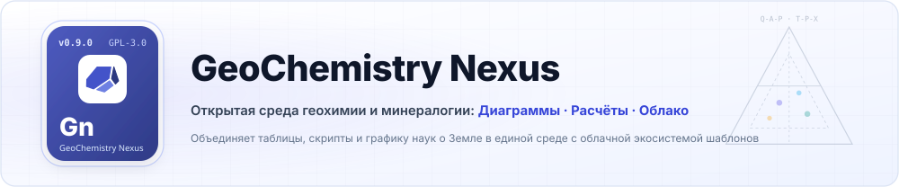
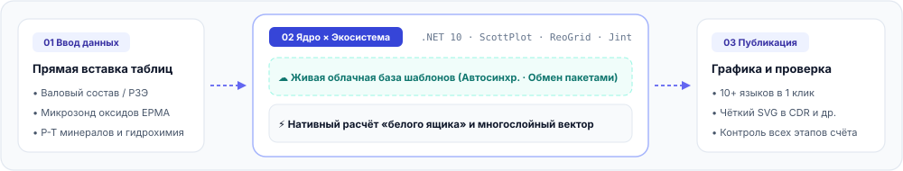

 

[English](../README.md) · [简体中文](./README.zh-CN.md) · [繁體中文](./README.zh-TW.md) · [Deutsch](./README.de-DE.md) · [Español](./README.es-ES.md) · [Français](./README.fr-FR.md) · [日本語](./README.ja-JP.md) · [한국어](./README.ko-KR.md) · [Português](./README.pt-BR.md) · **Русский**

<kbd>📥 <a href="https://github.com/MaxwellLei/GeoChemistry-Nexus/releases"><strong>Скачать установщик</strong></a></kbd> &nbsp; <kbd>🌐 <a href="https://geochemistry-nexus.pages.dev/ru/docs/intro"><strong>Сайт и документация</strong></a></kbd> &nbsp; <kbd>🧪 <a href="#-совместное-развитие-открытой-экосистемы-наук-о-земле"><strong>Предложить диаграмму / формулу</strong></a></kbd> &nbsp; <kbd>💬 <a href="https://github.com/MaxwellLei/GeoChemistry-Nexus/issues"><strong>Обратная связь и идеи</strong></a></kbd>

---

## 💡 Зачем создаётся GeoChemistry Nexus?

В геохимии, петрологии, минералогии и учении о рудных месторождениях повседневная работа часто разбита между разными программами: подготовка таблиц в электронных таблицах, расчёт геотермобарометров и кристаллохимических формул минералов в отдельных скриптах или устаревших утилитах, а затем перенос в графические редакторы для ручной отрисовки подложек — это разрывает рабочий процесс и приводит к ошибкам координат. В то же время многие классические геологические программы давно не обновляются, а новые дискриминационные диаграммы, термобарометрические калибровки и схемы поправок нередко остаются в приложениях к статьям без открытого канала распространения.

В полном соответствии с названием **Nexus (связующее звено)** проект построен по раздельной архитектуре **«нативное высокопроизводительное ядро + живая облачная экосистема шаблонов»**: настольный клиент остаётся предельно лёгким и быстрым, тогда как **дискриминационные диаграммы, геотермобарометры, модели микрозондового анализа (EPMA) и настольные микроинструменты непрерывно пополняются в облаке** по мере выхода новых научных публикаций — без необходимости обновлять саму программу.

  

## 🧭 Возможности программы

Выстраивая замкнутый цикл «петрогеохимия валового состава — микрозондовая минералогия — повседневные геологические расчёты», все модули на базе шаблонов поддерживают облачные обновления и пользовательские расширения (скриншоты и руководства см. на [официальном сайте и в онлайн-документации](https://geochemistry-nexus.pages.dev/ru/docs/intro)):

1. **Дискриминационные диаграммы и многомерная визуализация**: объединяет облачную библиотеку шаблонов, личное рабочее пространство и универсальные графические инструменты. Встроенные диаграммы постоянно расширяются от классификации магматических пород и тектонических обстановок к метаморфизму, литологии и рудогенезу; поддерживаются спайдер-диаграммы РЗЭ и микроэлементов (множество встроенных схем нормирования), многопанельные диаграммы Харкера, а также двумерные и тройные диаграммы рассеяния.
2. **Геотермобарометры и свободный лист формул**: облачная коллекция мономинеральных и двуминеральных термобарометров, оксибарометров, гигрометров и моделей температур насыщения постоянно пополняется. Доступен как пакетный расчёт по шаблону с протягиванием маркера заполнения, так и независимый свободный лист с вызовом функций `=ИмяФункции()` в стиле Excel для параллельного сравнения разных калибровок.
3. **Расчёт кристаллохимических формул минералов (EPMA)**: для локальных микрозондовых анализов оксидов онлайн-шаблоны охватывают породообразующие силикаты, акцессорные минералы, оксиды и сульфиды, автоматически выполняя нормирование по кислороду или катионам, распределение по кристаллографическим позициям (`apfu`), расчёт миналов и оценку зарядового баланса `Fe³⁺/Fe²⁺`.
4. **Нормативный пересчёт CIPW валового состава**: пакетный пересчёт 12 главных и 7 второстепенных / летучих компонентов (включая кислородную поправку для `CO₂ / SO₃ / F / Cl / S`) более чем в 30 идеальных нормативных минералов (`wt.%`) с учётом измеренного железа или разделения по `Fe³⁺/ΣFe`, расчётом насыщенности кремнезёмом, индекса глинозёмистости и проверкой сходимости баланса масс на уровне `10⁻⁶`.
5. **Числовые характеристики Ниггли и молекулярная норма**: использование катионных процентов (`cat.%`) устраняет весовое искажение тяжёлых элементов (например, Fe) и точнее отражает реальные объёмные соотношения минералов в шлифах. За один расчёт выдаются полный набор параметров Ниггли (`si, al, fm, c, alk, k, mg, qz, ti, p`) и молекулярная катанорма Барта–Ниггли (Catanorm), включая номер плагиоклаза `An%`, магнезиальный индекс и 7-ступенчатую схему десиликации.
6. **Геологический портал и набор быстрых инструментов**: главная страница объединяет быстрый доступ к ведущим геохимическим базам (`GEOROC`, `EarthChem`, `PetDB`, `GeoReM` и др.) и пополняемый набор компактных утилит: интерактивную геохимическую таблицу Менделеева, международную хроностратиграфическую шкалу ICS, конвертер элемент↔оксид, перевод геологических единиц, калькуляторы щёлочности / жёсткости воды и излучения абсолютно чёрного тела.

## ✨ Ключевые особенности

1. **Многоязычные шаблоны, переключение языка в один клик**: благодаря архитектуре многоязычного словарного сопоставления один и тот же построенный график мгновенно и без потерь переключает подписи между упрощённым и традиционным китайским, английским, немецким, французским, испанским, русским, японским, корейским, португальским и другими языками.
2. **Векторная графика издательского качества и прямая передача в редакторы**: 7 типов векторных слоёв на холсте (фигуративные точки, текст, стрелки, пользовательские кривые функций, отрезки, полигоны, оси) поддерживают тонкую настройку стиля; помимо экспорта в `SVG / PNG / JPG / BMP` и копирования в буфер обмена, график можно в один клик напрямую открыть в Inkscape, CorelDRAW или Adobe Illustrator без промежуточного сохранения файлов.
3. **Проверка по принципу «белого ящика», построчная индикация и трассировка**: никаких закрытых расчётов без понимания промежуточных шагов. Каждая строка таблиц геотермобарометрии, EPMA, CIPW и Ниггли снабжена динамическим индикатором состояния; выберите любую пробу, чтобы на боковой панели проверить коэффициенты нормирования, промежуточные логарифмические члены, способ учёта валентности железа и расход на стадиях десиликации при рецензировании статей и обучении.
4. **Программируемые шаблоны, встроенные визуальные редакторы и скрипты**: включает визуальные конструкторы диаграмм, термобарометров и EPMA, а также изолированную среду JavaScript на базе `Jint`. Новые дискриминационные границы или термодинамические уравнения можно упаковать с многоязычными подписями и RTF-описанием первоисточника без перекомпиляции программы — для обмена внутри научной группы или публикации в официальной облачной библиотеке.

## 📦 Загрузка и системные требования

Перейдите на страницу [**GitHub Releases**](https://github.com/MaxwellLei/GeoChemistry-Nexus/releases), чтобы скачать актуальный установщик для Windows. Настройка Python / R или других внешних сред не требуется.

### 📥 Какой установщик выбрать?

В каждом релизе есть два установщика с полностью одинаковыми возможностями. Разница лишь в том, включена ли в них среда выполнения .NET:

| Установщик | Пример имени файла | Описание | Подходит для |
| :--- | :--- | :--- | :--- |
| ✅ **Полный (рекомендуется)** | `GeoChemistryNexus-Setup-<версия>-x64.exe` | Включает .NET 10 Desktop Runtime; если на компьютере его нет, установщик автоматически установит его в тихом режиме | Большинства пользователей, особенно при первой установке или если неизвестно, установлен ли .NET |
| 🪶 **Облегчённый (Lite)** | `GeoChemistryNexus-Setup-<версия>-x64-lite.exe` | Имя файла заканчивается на `-lite`; среда выполнения .NET **не включена**, поэтому файл значительно меньше | Пользователей, у которых уже установлен [.NET 10 Desktop Runtime (x64)](https://dotnet.microsoft.com/download/dotnet/10.0), или тех, кто хочет сэкономить трафик |

> [!NOTE]
> - Облегчённый установщик сначала проверяет наличие .NET 10 Desktop Runtime. **Если среда не найдена, он покажет сообщение и завершит работу, не записав ни одного файла.** В этом случае скачайте полный установщик либо самостоятельно установите .NET и запустите Lite снова.
> - Не уверены, что выбрать? Просто скачайте **полный** установщик.

### 💻 Системные требования

| Параметр | Требования |
| :--- | :--- |
| 🖥️ **Операционная система** | Windows 7 SP1 / Windows 10 / Windows 11 (64-разрядная x64) |
| ⚙️ **Среда выполнения** | [.NET 10.0 Desktop Runtime (x64)](https://dotnet.microsoft.com/download/dotnet/10.0) (в полном установщике входит в комплект и ставится автоматически; для Lite её нужно установить заранее) |
| ⚡ **Размер программы** | Основной клиент около `9 MB` (версия без включённой среды выполнения .NET) |

## 🗺️ Дорожная карта

GeoChemistry Nexus — долгосрочный проект с открытым исходным кодом, рассчитанный на активную поддержку на протяжении пяти и более лет. Наряду с регулярным пополнением облачной библиотеки шаблонов развитие последовательно идёт по трём этапам (подробный план см. в [онлайн-документации · Roadmap](https://geochemistry-nexus.pages.dev/ru/docs/Roadmap)):

<table>
  <tr>
    <td width="33.3%" valign="top">
      
<strong>🟢 Этап 1 · Реализовано и постоянно развивается</strong>

      
<strong>Базовый цикл петрохимии и химии минералов</strong>

      <ul>
        <li>Междисциплинарные дискриминационные, спайдер- и Harker-диаграммы</li>
        <li>Геотермобарометры в стиле Excel и листы сравнения формул</li>
        <li>Облачная база шаблонов кристаллохимических формул EPMA</li>
        <li>Открытый пересчёт CIPW и Ниггли / Catanorm</li>
        <li>Локализация на 10+ языков и прямая связка с векторными редакторами</li>
      </ul>
    </td>
    <td width="33.3%" valign="top">
      
<strong>🔵 Этап 2 · Ближайшие приоритеты</strong>

      
<strong>Изотопная геохронология и геохимические фракталы</strong>

      <ul>
        <li>Модуль построения диаграмм с конкордией U-Pb по циркону</li>
        <li>Мультисистемные изохроны <code>Rb-Sr</code> / <code>Sm-Nd</code> / <code>Lu-Hf</code></li>
        <li>Геохимические фрактальные и мультифрактальные модели <code>C-N</code> / <code>C-A</code></li>
        <li>Кусочно-линейная аппроксимация в билогарифмических координатах и автоматическое выделение порога аномалий</li>
      </ul>
    </td>
    <td width="33.3%" valign="top">
      
<strong>🟣 Этап 3 · Средне- и долгосрочное видение</strong>

      
<strong>Интеллектуальные модели и кроссплатформенность</strong>

      <ul>
        <li>Классификация и оценка методами машинного обучения без настройки Python</li>
        <li>Поддержка расширяемых моделей «новых диаграмм», обученных на больших данных</li>
        <li>Научный RAG-ассистент на базе геологической литературы и встроенной справки</li>
        <li>Проработка перехода на <code>Avalonia UI</code> для нативной поддержки macOS / Linux</li>
      </ul>
    </td>
  </tr>
</table>

## 🤝 Совместное развитие открытой экосистемы наук о Земле

> [!IMPORTANT]
> **🧪 Исследователям и научным группам в области наук о Земле: сделайте ваши новые диаграммы и формулы доступными коллегам по всему миру!**
>
> Если вы или ваш коллектив опубликовали новые **тектонические/петрогенетические дискриминационные диаграммы, геотермобарометры, оксибарометры или методики минералого-геохимических расчётов**, приглашаем упаковать их в шаблон или связаться с нами для включения в официальную облачную библиотеку! В каждом добавленном шаблоне в справочной панели программы указываются **полная библиографическая ссылка на статью, имена авторов и ссылки на личную страницу или сайт лаборатории**, а авторы вносятся в почётный список участников проекта.

| Направление | Как присоединиться |
| :--- | :--- |
| 📈 **Диаграммы и алгоритмы** | Делитесь собственными пакетами шаблонов, предлагайте классические или новейшие формулы для добавления, помогайте проверять граничные условия и контрольные выборки |
| 💻 **Код и архитектура** | Разработчиков со знанием `C# / WPF`, научной визуализации, табличных движков или геохимических численных методов приглашаем делать Fork и отправлять Pull Request |
| 🌍 **Вычитка терминологии** | Помогайте совершенствовать перевод геологических терминов и онлайн-руководств на китайский, английский, немецкий, французский, испанский, русский, японский, корейский, португальский и другие языки |
| 🐛 **Сообщения об ошибках и идеи** | Заметили расхождение в расчётах, неудобство интерфейса или хотите предложить новую функцию — создайте обращение в [GitHub Issues](https://github.com/MaxwellLei/GeoChemistry-Nexus/issues) |

### 💬 Контакты и сообщество

1. **Почта автора**: [`maxwelllei@qq.com`](mailto:maxwelllei@qq.com) (отправка диаграмм и алгоритмов, научное и проектное сотрудничество)
2. **Группа QQ**: `1076647740`
3. **Сообщество Discord**: https://discord.gg/mRm8dbwa4W
4. **Вопросы и предложения**: [GitHub Issues](https://github.com/MaxwellLei/GeoChemistry-Nexus/issues)

## ⭐ Динамика Stars

🙏 Особая благодарность [всем участникам, помогающим в создании шаблонов, тестировании и многоязычной вычитке](https://geochemistry-nexus.pages.dev/ru/docs/Special%20Thanks)

**✨ Если GeoChemistry Nexus экономит ваше время в исследованиях или преподавании, поддержите долгосрочное развитие проекта звездой `Star ⭐` в правом верхнем углу! ✨**

Развивать открытое научное ПО в узкоспециализированной области наук о Земле непросто — нам действительно очень важны ваше внимание и поддержка: каждая звезда Star и каждая рекомендация коллегам придают нам сил двигаться дальше!

