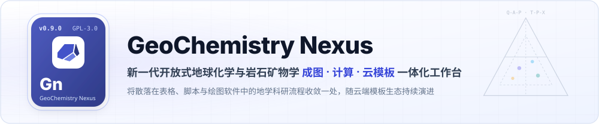

 

[English](../README.md) · **简体中文** · [繁體中文](./README.zh-TW.md) · [Deutsch](./README.de-DE.md) · [Español](./README.es-ES.md) · [Français](./README.fr-FR.md) · [日本語](./README.ja-JP.md) · [한국어](./README.ko-KR.md) · [Português](./README.pt-BR.md) · [Русский](./README.ru-RU.md)

<kbd>📥 <a href="https://github.com/MaxwellLei/GeoChemistry-Nexus/releases"><strong>下载最新版安装包</strong></a></kbd> &nbsp; <kbd>🌐 <a href="https://geochemistry-nexus.pages.dev/zh/docs/intro"><strong>官网演示与在线文档</strong></a></kbd> &nbsp; <kbd>🧪 <a href="#-共建地球科学开源生态"><strong>提交新图解 / 新公式</strong></a></kbd> &nbsp; <kbd>💬 <a href="https://github.com/MaxwellLei/GeoChemistry-Nexus/issues"><strong>问题反馈与建议</strong></a></kbd>

---

## 💡 为什么构建 GeoChemistry Nexus？

在地球化学、岩石学、矿物学与矿床学研究中，日常工作往往被拆散在不同软件之间：表格里整理数据、脚本或旧程序里算温压计与矿物化学式、再切去通用绘图软件描底图——不仅链路割裂，手工转绘还容易引入坐标误差。与此同时，许多传统地学工具长期停更，而新发表的判别图解、温压标定公式与校正方案往往停留在论文附录里，缺乏持续触达同行的开放渠道。

正如名称中的 **Nexus（连接中枢）** 所寓意，本项目采用**「原生高性能内核 + 云端活态模板生态」**的解耦设计：客户端保持极致轻快，而上层的**判别图解、地质温压计、电子探针（EPMA）矿物模型与桌面微工具库则随学科文献进展在云端持续更新增加**，无需升级软件即可直接获取最新科研模型。

  

## 🧭 能做什么

围绕「岩石地球化学—微区矿物学—日常地学查算」构建完整闭环，所有模板驱动型模块均支持云端持续上新与自定义扩展（界面截图与操作演示见 [官方网站与在线文档](https://geochemistry-nexus.pages.dev/zh/docs/intro)）：

1. **判别图解与多维可视化**：集云端模板库、个人工作区与通用工具图解于一体。内置图解从火成岩分类与构造背景判别，持续向变质、沉积、矿床成因等多学科体系扩充；同时原生配备稀土（REE）/ 微量元素蛛网图（内置多套标准化方案）、Harker 哈克多联图及二维 / 三元散点投图。
2. **地质温压计与自由公式表**：云端持续收录并迭代单矿物、矿物对温压计以及氧逸度计、湿度计、饱和温度模型。既可按模板列引导拖拽填充柄批量计算，也可开启独立自由工作表，像使用 Excel 一样输入 `=函数名()` 在同一张表内横向对比多套标定公式。
3. **EPMA 电子探针矿物解算**：面向微区氧化物分析数据，在线模板库不断覆盖造岩硅酸盐、副矿物及氧化物 / 硫化物族系，自动完成氧原子或阳离子基准归一化、晶位分配（`apfu`）、端元比例拆解与 `Fe³⁺/Fe²⁺` 电价平衡估算。
4. **CIPW 全岩标准矿物计算**：支持 12 项主量与 7 项次要 / 挥发分组分（含 `CO₂ / SO₃ / F / Cl / S` 氧置换校正）批量换算 30 余种理想标准矿物（`wt.%`），自动识别实测铁或按 `Fe³⁺/ΣFe` 拆分，实时给出硅饱和度、铝饱和指数与 `10⁻⁶` 级质量平衡闭合检验。
5. **Niggli 参数与分子标准矿物**：以阳离子百分比（`cat.%`）消除铁等重元素在质量分数中的偏倚，更贴合薄片真实矿物体积比例。单次输入同步输出完整尼格里参数（`si, al, fm, c, alk, k, mg, qz, ti, p`）与 Barth–Niggli 分子标准矿物（Catanorm），附斜长石 `An%`、镁指数与七步去硅历程。
6. **地学资源门户与随手工具箱**：首页聚合 `GEOROC`、`EarthChem`、`PetDB`、`GeoReM` 等权威地球化学数据库直达入口，并内置持续丰富的交互式地球化学周期表、ICS 国际年代地层速查卡、元素↔氧化物换算、地质常用单位换算及水样碱度 / 硬度、黑体辐射计算器等轻量小组件。

## ✨ 核心特性

1. **多语言模板，不同语种一键切换**：图解底层采用多语种词条映射架构，同一份投图成果可一键无损切换简中、繁中、英、德、法、西、俄、日、韩、葡等多种语言标注。
2. **出版级矢量，直连主流修图软件**：画布内 7 类矢量图层（数据点、文本、箭头、自定义函数曲线、线段、多边形、坐标轴）支持样式微调；除导出 `SVG / PNG / JPG / BMP` 与剪贴板速贴外，更可跳过手动存盘中转，一键唤醒 Inkscape、CorelDRAW 或 Adobe Illustrator 继续拼版精修。
3. **白盒化核查，逐行状态灯与过程追溯**：拒绝“只给结果、不知过程”的黑箱计算。温压计、EPMA、CIPW 与 Niggli 工作表每行均配有动态诊断状态灯，点选任意样品即可在侧栏逐项审阅归一化系数、中间对数项、铁价态处理方式及去硅反应消耗量，便于审稿溯源与教学复核。
4. **模板可编程，内置可视化与脚本构建器**：内置图解、温压计与 EPMA 可视化编辑器及 `Jint` JavaScript 脚本沙箱。课题组新发表的判别边界或热力学经验公式无需重编译软件，即可封装为含多语种词条与 RTF 文献说明的标准模板包，一键导出在团队间共享或提交并入官方云端库。

## 📦 下载与运行环境

前往 [**GitHub Releases**](https://github.com/MaxwellLei/GeoChemistry-Nexus/releases) 下载最新 Windows 安装包。无需配置任何 Python / R 等环境。

### 📥 如何选择安装包

每个版本提供两种安装包，功能完全一致，区别仅在于是否内置 .NET 运行时：

| 安装包 | 文件名示例 | 说明 | 适用人群 |
| :--- | :--- | :--- | :--- |
| ✅ **完整版（推荐）** | `GeoChemistryNexus-Setup-<版本>-x64.exe` | 内置 .NET 10 桌面运行时；若本机尚未安装，安装程序会自动静默安装，无需手动操作 | 大多数用户，尤其是首次安装、不确定电脑是否已装 .NET 的用户 |
| 🪶 **精简版（Lite）** | `GeoChemistryNexus-Setup-<版本>-x64-lite.exe` | 文件名带 `-lite`，**不含** .NET 运行时，安装包体积小得多 | 已安装 [.NET 10 Desktop Runtime (x64)](https://dotnet.microsoft.com/download/dotnet/10.0) 的用户，或希望节省下载流量的用户 |

> [!NOTE]
> - 运行精简版时，安装程序会先检测本机是否已安装 .NET 10 桌面运行时。**若未检测到，将提示并终止安装（不会写入任何文件）**，此时请改用完整版安装包，或先自行安装 .NET 运行时后再重试。
> - 若不确定该选哪个，直接下载**完整版**即可。

### 💻 运行环境

| 项目 | 规格要求 |
| :--- | :--- |
| 🖥️ **操作系统** | Windows 7 SP1 / Windows 10 / Windows 11（64 位 x64） |
| ⚙️ **运行环境** | [.NET 10.0 Desktop Runtime (x64)](https://dotnet.microsoft.com/download/dotnet/10.0)（完整版安装包已内置并自动安装，精简版需自行预先安装） |
| ⚡ **软件体积** | 客户端本体约 `9 MB`（不含 .NET 运行时版本） |

## 🗺️ 路线图

GeoChemistry Nexus 是一项计划持续维护五年以上的长期开源工程。在高频扩充现有云端模板库的同时，正沿以下三个阶段稳步推进（完整规划见 [在线文档 · Roadmap](https://geochemistry-nexus.pages.dev/zh/docs/Roadmap)）：

<table>
  <tr>
    <td width="33.3%" valign="top">
      
<strong>🟢 阶段一 · 已就绪并持续生长</strong>

      
<strong>岩石与矿物化学核心闭环</strong>

      <ul>
        <li>多学科判别图解、蛛网图与 Harker 多联图</li>
        <li>类 Excel 地质温压计与自由公式对比表</li>
        <li>EPMA 微区矿物结构式云端模板库</li>
        <li>CIPW 与 Niggli / Catanorm 白盒解算</li>
        <li>10+ 语种国际化与第三方矢量软件直连</li>
      </ul>
    </td>
    <td width="33.3%" valign="top">
      
<strong>🔵 阶段二 · 近期重点推进</strong>

      
<strong>同位素年代学与地球化学分形</strong>

      <ul>
        <li>锆石 U-Pb 谐和图（Concordia）成图模块</li>
        <li><code>Rb-Sr</code> / <code>Sm-Nd</code> / <code>Lu-Hf</code> 等多元等时线</li>
        <li><code>C-N</code> / <code>C-A</code> 等地球化学分形与多重分形模型</li>
        <li>双对数分段拟合与化探背景 / 异常下限自动划分</li>
      </ul>
    </td>
    <td width="33.3%" valign="top">
      
<strong>🟣 阶段三 · 中长期演进愿景</strong>

      
<strong>智能判别模型与全平台生态</strong>

      <ul>
        <li>免配 Python 环境的地球化学机器学习分类评估</li>
        <li>支持加载大数据训练的可扩展「新图解」判别模型</li>
        <li>融合地球科学文献与内置知识库的 RAG 科研助手</li>
        <li>评估推进 <code>Avalonia UI</code> 架构，原生支持 macOS / Linux</li>
      </ul>
    </td>
  </tr>
</table>

## 🤝 共建地球科学开源生态

> [!IMPORTANT]
> **🧪 致地球科学研究者与课题组：让您的新图解与新公式被全球同行直接调用！**
>
> 如果您或您的团队发表了新的**构造/成因判别图解、地质温压计、氧逸度计或矿物化学计算方法**，欢迎封装或联系我们收录进官方云端模板库！所有收录模板均会在软件说明面板中**完整标注原论文引用、作者署名及个人/课题组主页链接**，并列入贡献者致谢名录，让学术成果跨越论文附录，真正成为同行日常高频调用的研究工具。

| 参与方向 | 您可以如何加入 |
| :--- | :--- |
| 📈 **图解与算法共建** | 分享自研模板包、推荐领域内亟需收录的经典/前沿公式，或协助校验现有模型的边界条件与测试集 |
| 💻 **代码与架构贡献** | 欢迎熟悉 `C# / WPF`、科学可视化、电子表格引擎或地球化学数值计算的开发者 Fork 仓库并提交 Pull Request |
| 🌍 **多语种术语校对** | 协助润色中、英、德、法、西、俄、日、韩、葡等语种的地学专业术语本地化与在线教程翻译 |
| 🐛 **异常反馈与建议** | 发现计算偏差、界面交互问题或有新功能构想，请随时提交至 [GitHub Issues](https://github.com/MaxwellLei/GeoChemistry-Nexus/issues) |

### 💬 联系与交流

1. **作者邮箱**：[`maxwelllei@qq.com`](mailto:maxwelllei@qq.com)（图解与算法投稿、学术及项目合作）
2. **QQ 交流群**：`1076647740`
3. **Discord 社区**：https://discord.gg/mRm8dbwa4W
4. **问题反馈与建议**：[GitHub Issues](https://github.com/MaxwellLei/GeoChemistry-Nexus/issues)

## ⭐ Star 增长趋势

🙏 特别感谢[所有参与模板建设、测试反馈与多语种校对的贡献者](https://geochemistry-nexus.pages.dev/zh/docs/Special%20Thanks)

**✨ 如果 GeoChemistry Nexus 为您的科研或教学节省了时间，欢迎点亮右上角 `Star ⭐` 支持项目长期演进！ ✨**

地学垂直领域的开源软件步履不易，我们真的非常需要您的关注与支持——您的每一颗 Star 与每一次向身边同行的推荐，都是支撑项目持续走下去的最大动力！

