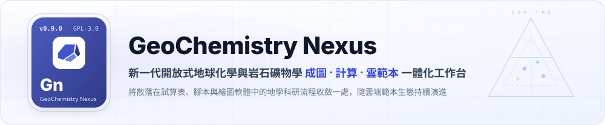

 

[English](../README.md) · [简体中文](./README.zh-CN.md) · **繁體中文** · [Deutsch](./README.de-DE.md) · [Español](./README.es-ES.md) · [Français](./README.fr-FR.md) · [日本語](./README.ja-JP.md) · [한국어](./README.ko-KR.md) · [Português](./README.pt-BR.md) · [Русский](./README.ru-RU.md)

<kbd>📥 <a href="https://github.com/MaxwellLei/GeoChemistry-Nexus/releases"><strong>下載最新版安裝程式</strong></a></kbd> &nbsp; <kbd>🌐 <a href="https://geochemistry-nexus.pages.dev/zh-Hant/docs/intro"><strong>官網展示與線上文件</strong></a></kbd> &nbsp; <kbd>🧪 <a href="#-共建地球科學開源生態"><strong>提交新圖解 / 新公式</strong></a></kbd> &nbsp; <kbd>💬 <a href="https://github.com/MaxwellLei/GeoChemistry-Nexus/issues"><strong>問題回報與建議</strong></a></kbd>

---

## 💡 為什麼構建 GeoChemistry Nexus？

在地球化學、岩石學、礦物學與礦床學研究中，日常工作往往被拆散在不同軟體之間：試算表裡整理資料、腳本或舊程式裡算溫壓計與礦物化學式、再切去通用繪圖軟體描底圖——不僅流程割裂，手工轉繪還容易引入座標誤差。與此同時，許多傳統地學工具長期停更，而新發表的判別圖解、溫壓標定公式與校正方案往往停留在論文附錄裡，缺乏持續觸達同行的開放管道。

正如名稱中的 **Nexus（連結中樞）** 所寓意，本專案採用**「原生高效能核心 + 雲端活態範本生態」**的解耦設計：用戶端保持極致輕快，而上層的**判別圖解、地質溫壓計、電子微探針（EPMA）礦物模型與桌面微工具庫則隨學科文獻進展在雲端持續更新增加**，無需升級軟體即可直接取得最新科研模型。

  

## 🧭 能做什麼

圍繞「岩石地球化學—微區礦物學—日常地學查算」構建完整閉環，所有範本驅動型模組均支援雲端持續上新與自訂擴充（介面截圖與操作示範見 [官方網站與線上文件](https://geochemistry-nexus.pages.dev/zh-Hant/docs/intro)）：

1. **判別圖解與多維視覺化**：集雲端範本庫、個人工作區與通用工具圖解於一體。內建圖解從火成岩分類與構造背景判別，持續向變質、沉積、礦床成因等多學科體系擴充；同時原生配備稀土（REE）/ 微量元素蛛網圖（內建多套標準化方案）、Harker 哈克多聯圖及二維 / 三元散佈投圖。
2. **地質溫壓計與自由公式表**：雲端持續收錄並迭代單礦物、礦物對溫壓計以及氧逸度計、濕度計、飽和溫度模型。既可按範本欄引導拖曳填滿控點批次計算，也可開啟獨立自由工作表，像使用 Excel 一樣輸入 `=函數名()` 在同一張表內橫向對比多套標定公式。
3. **EPMA 電子微探針礦物解算**：面向微區氧化物分析資料，線上範本庫不斷涵蓋造岩矽酸鹽、副礦物及氧化物 / 硫化物族系，自動完成氧原子或陽離子基準歸一化、晶位分配（`apfu`）、端元比例拆解與 `Fe³⁺/Fe²⁺` 電價平衡估算。
4. **CIPW 全岩標準礦物計算**：支援 12 項主量與 7 項次要 / 揮發分組分（含 `CO₂ / SO₃ / F / Cl / S` 氧置換校正）批次換算 30 餘種理想標準礦物（`wt.%`），自動識別實測鐵或按 `Fe³⁺/ΣFe` 拆分，即時給出矽飽和度、鋁飽和指數與 `10⁻⁶` 級質量平衡閉合檢驗。
5. **Niggli 參數與分子標準礦物**：以陽離子百分比（`cat.%`）消除鐵等重元素在質量分數中的偏倚，更貼合薄片真實礦物體積比例。單次輸入同步輸出完整尼格里參數（`si, al, fm, c, alk, k, mg, qz, ti, p`）與 Barth–Niggli 分子標準礦物（Catanorm），附斜長石 `An%`、鎂指數與七步去矽歷程。
6. **地學資源門戶與隨手工具箱**：首頁聚合 `GEOROC`、`EarthChem`、`PetDB`、`GeoReM` 等權威地球化學資料庫直達入口，並內建持續豐富的互動式地球化學週期表、ICS 國際年代地層速查卡、元素↔氧化物換算、地質常用單位換算及水樣鹼度 / 硬度、黑體輻射計算器等輕量小工具。

## ✨ 核心特性

1. **多語言範本，不同語種一鍵切換**：圖解底層採用多語種詞條映射架構，同一份投圖成果可一鍵無損切換簡中、繁中、英、德、法、西、俄、日、韓、葡等多種語言標註。
2. **出版級向量，直連主流修圖軟體**：畫布內 7 類向量圖層（資料點、文字、箭頭、自訂函數曲線、線段、多邊形、座標軸）支援樣式微調；除匯出 `SVG / PNG / JPG / BMP` 與剪貼簿速貼外，更可跳過手動存檔中轉，一鍵喚醒 Inkscape、CorelDRAW 或 Adobe Illustrator 繼續拼版精修。
3. **白盒化核查，逐列狀態燈與過程追溯**：拒絕「只給結果、不知過程」的黑箱計算。溫壓計、EPMA、CIPW 與 Niggli 工作表每列均配有動態診斷狀態燈，點選任意樣品即可在側欄逐項審閱歸一化係數、中間對數項、鐵價態處理方式及去矽反應消耗量，便於審稿溯源與教學覆核。
4. **範本可程式化，內建視覺化與腳本建構器**：內建圖解、溫壓計與 EPMA 視覺化編輯器及 `Jint` JavaScript 腳本沙箱。課題組新發表的判別邊界或熱力學經驗公式無需重新編譯軟體，即可封裝為含多語種詞條與 RTF 文獻說明的標準範本包，一鍵匯出在團隊間分享或提交併入官方雲端庫。

## 📦 下載與執行環境

前往 [**GitHub Releases**](https://github.com/MaxwellLei/GeoChemistry-Nexus/releases) 下載最新 Windows 安裝程式。無需設定任何 Python / R 等環境。

### 📥 如何選擇安裝程式

每個版本提供兩種安裝程式，功能完全一致，差別僅在於是否內建 .NET 執行階段：

| 安裝程式 | 檔名範例 | 說明 | 適用對象 |
| :--- | :--- | :--- | :--- |
| ✅ **完整版（建議）** | `GeoChemistryNexus-Setup-<版本>-x64.exe` | 內建 .NET 10 桌面執行階段；若本機尚未安裝，安裝程式會自動靜默安裝，無需手動操作 | 大多數使用者，尤其是首次安裝、不確定電腦是否已安裝 .NET 的使用者 |
| 🪶 **精簡版（Lite）** | `GeoChemistryNexus-Setup-<版本>-x64-lite.exe` | 檔名帶 `-lite`，**不含** .NET 執行階段，安裝程式體積小得多 | 已安裝 [.NET 10 Desktop Runtime (x64)](https://dotnet.microsoft.com/download/dotnet/10.0) 的使用者，或希望節省下載流量的使用者 |

> [!NOTE]
> - 執行精簡版時，安裝程式會先偵測本機是否已安裝 .NET 10 桌面執行階段。**若未偵測到，將提示並終止安裝（不會寫入任何檔案）**，此時請改用完整版安裝程式，或先自行安裝 .NET 執行階段後再重試。
> - 若不確定該選哪個，直接下載**完整版**即可。

### 💻 執行環境

| 項目 | 規格要求 |
| :--- | :--- |
| 🖥️ **作業系統** | Windows 7 SP1 / Windows 10 / Windows 11（64 位元 x64） |
| ⚙️ **執行環境** | [.NET 10.0 Desktop Runtime (x64)](https://dotnet.microsoft.com/download/dotnet/10.0)（完整版安裝程式已內建並自動安裝，精簡版需自行預先安裝） |
| ⚡ **軟體體積** | 用戶端本體約 `9 MB`（不含 .NET 執行階段版本） |

## 🗺️ 路線圖

GeoChemistry Nexus 是一項計畫持續維護五年以上的長期開源工程。在高頻擴充現有雲端範本庫的同時，正沿以下三個階段穩步推進（完整規劃見 [線上文件 · Roadmap](https://geochemistry-nexus.pages.dev/zh-Hant/docs/Roadmap)）：

<table>
  <tr>
    <td width="33.3%" valign="top">
      
<strong>🟢 階段一 · 已就緒並持續生長</strong>

      
<strong>岩石與礦物化學核心閉環</strong>

      <ul>
        <li>多學科判別圖解、蛛網圖與 Harker 多聯圖</li>
        <li>類 Excel 地質溫壓計與自由公式對比表</li>
        <li>EPMA 微區礦物結構式雲端範本庫</li>
        <li>CIPW 與 Niggli / Catanorm 白盒解算</li>
        <li>10+ 語種國際化與第三方向量軟體直連</li>
      </ul>
    </td>
    <td width="33.3%" valign="top">
      
<strong>🔵 階段二 · 近期重點推進</strong>

      
<strong>同位素年代學與地球化學分形</strong>

      <ul>
        <li>鋯石 U-Pb 諧和圖（Concordia）成圖模組</li>
        <li><code>Rb-Sr</code> / <code>Sm-Nd</code> / <code>Lu-Hf</code> 等多元等時線</li>
        <li><code>C-N</code> / <code>C-A</code> 等地球化學分形與多重分形模型</li>
        <li>雙對數分段擬合與化探背景 / 異常下限自動劃分</li>
      </ul>
    </td>
    <td width="33.3%" valign="top">
      
<strong>🟣 階段三 · 中長期演進願景</strong>

      
<strong>智慧判別模型與全平台生態</strong>

      <ul>
        <li>免設 Python 環境的地球化學機器學習分類評估</li>
        <li>支援載入大數據訓練的可擴充「新圖解」判別模型</li>
        <li>融合地球科學文獻與內建知識庫的 RAG 科研助手</li>
        <li>評估推進 <code>Avalonia UI</code> 架構，原生支援 macOS / Linux</li>
      </ul>
    </td>
  </tr>
</table>

## 🤝 共建地球科學開源生態

> [!IMPORTANT]
> **🧪 致地球科學研究者與課題組：讓您的新圖解與新公式被全球同行直接調用！**
>
> 如果您或您的團隊發表了新的**構造/成因判別圖解、地質溫壓計、氧逸度計或礦物化學計算方法**，歡迎封裝或聯繫我們收錄進官方雲端範本庫！所有收錄範本均會在軟體說明面板中**完整標註原論文引用、作者署名及個人/課題組主頁連結**，並列入貢獻者致謝名錄，讓學術成果跨越論文附錄，真正成為同行日常高頻調用的研究工具。

| 參與方向 | 您可以如何加入 |
| :--- | :--- |
| 📈 **圖解與演算法共建** | 分享自研範本包、推薦領域內亟需收錄的經典/前沿公式，或協助校驗現有模型的邊界條件與測試集 |
| 💻 **程式碼與架構貢獻** | 歡迎熟悉 `C# / WPF`、科學視覺化、電子試算表引擎或地球化學數值計算的開發者 Fork 儲存庫並提交 Pull Request |
| 🌍 **多語種術語校對** | 協助潤飾中、英、德、法、西、俄、日、韓、葡等語種的地學專業術語在地化與線上教學翻譯 |
| 🐛 **異常回報與建議** | 發現計算偏差、介面互動問題或有新功能構想，請隨時提交至 [GitHub Issues](https://github.com/MaxwellLei/GeoChemistry-Nexus/issues) |

### 💬 聯繫與交流

1. **作者信箱**：[`maxwelllei@qq.com`](mailto:maxwelllei@qq.com)（圖解與演算法投稿、學術及專案合作）
2. **QQ 交流群**：`1076647740`
3. **Discord 社群**：https://discord.gg/mRm8dbwa4W
4. **問題回報與建議**：[GitHub Issues](https://github.com/MaxwellLei/GeoChemistry-Nexus/issues)

## ⭐ Star 成長趨勢

🙏 特別感謝[所有參與範本建設、測試回饋與多語種校對的貢獻者](https://geochemistry-nexus.pages.dev/zh-Hant/docs/Special%20Thanks)

**✨ 如果 GeoChemistry Nexus 為您的科研或教學節省了時間，歡迎點亮右上角 `Star ⭐` 支持專案長期演進！ ✨**

地學垂直領域的開源軟體步履不易，我們真的非常需要您的關注與支持——您的每一顆 Star 與每一次向身邊同行的推薦，都是支撐專案持續走下去的最大動力！

